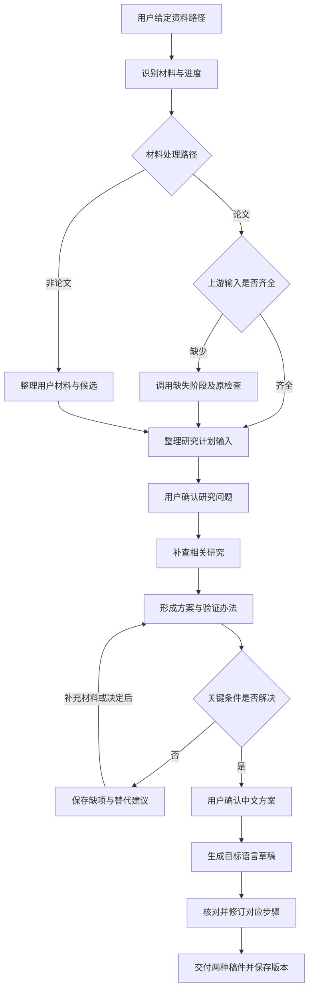

# 研究计划草稿技能执行计划

整理日期：2026 年 11 月 2 日；接口约定补充：2026 年 11 月 3 日。

本文保留已确认的业务要求，并落实第二阶段的真实前置条件、固定版本的 Nix 依赖组合、材料读写及稿件提交与恢复。本次补清主技能调用组件所用的公开接口，使测试步骤可以在产品实现之前按同一约定编写。首版由一个主技能承担研究计划自己的工作，上游要求的代理照常调用。本轮只修订计划，不修改产品代码、不运行产品测试。

- `Requirement revision`：`rp-requirements-2026-11-02-q6-q16`，以本文件保留的已确认要求为准；本轮三条意见要求补齐实现安排，不增加业务范围。
- `Plan revision`：`rp-plan-r3-2026-11-03`。
- `Target repository revision`：已建立 `research-proposal` 本地 Git 仓库及 `feat/research-proposal` 开发工作树，尚无提交；仓库和技能名采用 `research-proposal`，源码采用 `skills/research-proposal/`。
- `Proposed review status`：`pending`，正式结论由独立计划审核记录给出。
- 唯一完整计划位于 `research-proposal` 仓库的 `feat/research-proposal` 开发工作树内，即 `worktrees/research-proposal-plan/plan/implementation-plan.md`。总目录中的原文件只保留指向这里的说明；审核记录同存于本工作树的 `plan/implementation-plan-review.md`。

目标为工作区下的独立技能仓库 `research-proposal`，本地仓库与开发工作树已建立。首版面向日本高校修士申请，学科不限，具体用于联系教授、正式申请或面试准备。它接收用户给定的资料路径，整理已有研究材料；论文路线按需调用现有工作流补齐输入，非论文路线首先处理用户提供的材料，最终生成可继续修改的研究计划草稿。

**已确认的方向**如下：

- 论文路线支持直接使用 professor-contact 已有产物，用户无需逐个提供文件；尚未运行时，新技能负责调用所需前置流程。
- 专著、史料、作品等可以作为主要研究材料，按类型处理并保留出处和定位信息。首版支持用户提供的材料，暂不承诺自动采集各种档案库和作品平台。
- 通过依赖复用原仓库的入口、脚本、代理和检查规则，相关产物仍由原仓库负责生成。
- 每个选题都补查教授之外的相关研究；影响研究能否开展的关键条件须先解决，再生成完整正文。
- 研究计划在选定研究问题和确认中文研究方案两处取得用户决定；已有确认和明确授权继续有效。
- 每份草稿绑定一个申请项目、一种用途和一个核心研究问题，可包含必要的子问题；同题申请其他学校时另存稿件。
- 首版交付内容一致的 Word 和 Markdown，支持读取用户修改稿继续修订，并保存稿件版本和中断进度。
- Nix 是主要安装入口，同时支持通过 npx skills 安装技能及随附资源。
- 新仓库不以 `.apm` 作为目录或安装前提，两种安装方式共用一份技能源码。
- 首版由一个主技能组织材料整理、研究设计、写作和核对，暂不新增研究计划专用代理；上游要求的代理照常安装和调用。
- 首版完整流程以“苹果芯片 Mac、Codex、Nix”为支持目标，通过实际验证后再声明可用；其他组合分别验证后增加。
- 研究计划与套磁邮件各自保存选择和后续状态，共用前面的论文证据与候选想法。

**写作依据**来自用户提供的本地参考文件 `RP.docx`；原件及其私人路径不纳入产品仓库。保留其中的写作顺序：为什么研究、想解决什么问题、准备怎么做、预期得到什么。文档中的题目、个人经历、研究方法和引用只作示范，不自动成为申请者事实或默认选题。

实际章节、语言、栏目和篇幅以目标学校的正式要求为准。研究计划需要额外说明相关研究、验证办法、可行性和进度时，由新流程补齐；这些内容是本次工作流建议，并非参考文档强制规定的栏目。

**用户提供路径后，技能自动发现材料**。输入可以是专攻目录、`教授研究` 目录、单个教授目录、某份具体产物，或用户提供的专著、史料、作品等材料的路径。技能在给定资料范围内识别材料类型、已有产物、所属申请项目或教授、研究方向和当前进度，并展示可用材料、可继续的选题和缺项。

已有明确的教授、方向或选题决定时直接使用；存在多个可选对象而用户尚未指定时，展示选项后取得决定。不能按目录顺序、展示名称或模型偏好替用户选题，也不能仅凭文件存在就认定阶段已经完成。

现有材料的用途如下：

| 现有材料 | 研究计划中的用途 | 使用限制 |
|---|---|---|
| `info.json`、`boshu_analysis.json`、招生说明和正式申请表 | 确定学校、专攻、年度、用途、语言、篇幅和提交要求 | 核对适用年度与专攻；往年材料只能作为暂定参考 |
| `papers.json` | 找到论文条目、题名、年份、作者及全文可用情况 | 论文存在或下载完成，不代表已经分析全文 |
| `方向预筛.json` | 展示摘要支持的初步方向，帮助选择范围 | 初步分类不能直接作为全文结论或研究空白的证明 |
| `套磁候选输入.json` | 复用论文事实、方向、作者后续工作及已有核对结果 | 保留来源、证据范围和不确定性 |
| `套磁候选状态.json` | 复用候选想法、研究问题、支撑论文和风险提示 | 每份研究计划围绕一个核心问题及必要子问题展开，不能简单拼接多个候选 |
| 已有套磁选择 | 作为研究计划选题的预选信息 | 研究计划单独保存自己的选择，不自动把所有邮件选题写成研究计划 |
| 个人资料、`方向素材.json`、用户补充 | 写真实动机、已有准备、兴趣和条件 | 只采用用户实际提供的经历；不把兴趣改写成已经掌握的能力 |
| 论文全文分析及其事实文件、作者后续工作证据文件 | 支撑相关研究、方法比较和选题依据 | 区分论文结果、作者建议和申请者设想；必要时补读关键段落 |
| 教授导读、问答和知识库报告 | 帮助理解术语、研究方向和个人兴趣 | 作为辅助阅读材料，不替代论文证据或用户选择 |
| 用户提供的专著、史料、作品及其他非论文材料 | 支撑研究对象、问题、相关研究和方法选择 | 按类型保留出处、页码、章节、档案编号或其他定位信息，不套用论文的“作者后续工作” |

读取上游产物时，主要采用结构化文件，Markdown 用于展示和辅助理解，不从上游受管 Markdown 反向拼出缺失的正式状态。这与 [professor-contact 的现有产物分工](https://github.com/ScholarWorkflow/professor-contact/blob/ad096fe31a4b5694cbe47a40f37b621435e1eeec/.apm/skills/professor-contact/docs/workflow-reference.md#L80)保持一致。研究计划自己的 Word 或 Markdown 修改稿可以在用户指定后读入，更新本稿内容及状态；这不改变上游正式状态的生成方式。

非论文材料由新技能按类型整理和引用。尚无明确研究问题时，提出少量相互有区别的候选，每个说明材料依据、研究价值、可采用的方法和主要缺项，再由用户选择或修改。这部分的输入、候选和选择保存在研究计划自己的状态中，不要求生成套磁候选文件；论文路线继续复用上游流程。

招生材料还需要单独检查正式研究计划表格。现有招生分析会跳过空白表格，而栏目、页数和填写提示可能就在表上，不能仅凭已有招生摘要认定要求齐全。相关依据见工作区的[招生材料处理规则](../../../StudyCoachWorkflow/admissions-data/.apm/skills/boshu-analyzer/SKILL.md:114)。

**论文路线的前置流程按已有进度继续**。“此前没有跑过 professor-contact”只影响从哪一步开始，不应要求用户先手工运行完整套磁流程。以下条件均以原流程检查认可的有效产物为准。

| 发现的有效材料 | 下一步 |
|---|---|
| 已有有效的 `套磁候选输入.json` 和候选想法 | 直接进入研究计划选题与设计 |
| 已有有效的 `套磁候选输入.json`，缺候选想法 | 调用 professor-contact 第三阶段 |
| 已有论文分析报告或事实文件，但缺少有效的 `套磁候选输入.json` | 先检查该教授的有效 `套磁目标.json` 和第一阶段候选快照；缺失或失效时补齐所需预筛、阶段 0、阶段 1，再由第二阶段按原规则复用分析、生成输入包，最后调用第三阶段 |
| 已完成第一阶段，尚未形成正式输入包 | 调用 professor-contact 第二、第三阶段 |
| 已有方向预筛 | 沿用或取得方向选择，再调用第一至第三阶段 |
| 已有教授论文资料，缺方向预筛 | 调用 professor-research 的方向预筛，再进入后续阶段 |
| 只有合格的招生项目资料，尚未整理教授研究 | 调用 professor-research 的采集、预筛，再进入 professor-contact 前置阶段 |

调用上述上游流程，仍需要足够的招生项目或教授信息。只有一个空目录、学校名称或原始网页时，还需要说明和补齐前置资料；本次讨论尚未把“从任意网页建立完整招生项目目录”纳入新仓库职责。非论文路线可以从用户提供的材料开始整理，同时补齐本稿所属申请项目、用途和要求。

第三阶段不会直接读取论文全文、分析报告、事实文件或 `论文分析/_index.json`，因此不能把这些零散材料视为可直接进入第三阶段的正式输入。相关依据见[第三阶段读取范围](https://github.com/ScholarWorkflow/professor-contact/blob/ad096fe31a4b5694cbe47a40f37b621435e1eeec/.apm/agents/professor-contact-idea-generator.agent.md#L24)。

进入第二阶段前，新技能的路由组件依次落实以下步骤，不能将“发现分析报告”作为跳过条件：

1. 绑定本次申请资料根目录和单个教授目录。原有目标状态由 `contact_targets resolve --target-file` 核对；缺目标、选择已失效或需要新选择时，先补有效预筛，再委派阶段 0 的 `professor-contact` 取得或沿用真实用户决定。
2. 委派 `professor-contact-downloader` 完成该教授第一阶段。它使用同一目标文件检查或建立候选快照，仅补齐缺少的候选全文，并在补齐后重建快照。
3. 将同一目标文件交给 `professor-contact-analyzer`。该代理按原约定先验证第一阶段快照，再运行第二阶段预检；既有分析能否复用由原来的论文身份、来源和缓存检查决定，不能按标题相似或文件名直接挂接。
4. 第二阶段生成有效输入包后才进入第三阶段。已有有效输入包可按上表直接交第三阶段，不为执行这份前置清单而重跑第二阶段。

这一顺序依据 contact 基线 `ad096fe31a4b5694cbe47a40f37b621435e1eeec` 的[第二阶段预检](https://github.com/ScholarWorkflow/professor-contact/blob/ad096fe31a4b5694cbe47a40f37b621435e1eeec/.apm/skills/professor-contact/scripts/_stage2_preflight.py#L877)：代码先读目标，再读教授本地第一阶段快照；缺少快照时返回 `missing_stage1_snapshot`，不会进入分析复用路径。修订只改变新技能的调用顺序，不改变上游前置检查。

补齐时复用原流程的检查、缓存和恢复行为。已有有效产物直接复用；缺失或经原流程判定失效的部分交给对应阶段处理。教授和方向选择、需要下载全文时的访问方式、原流程要求的执行通道和处理范围选择、全文分析后的方向变更，以及追加校验轮次等用户决定仍然有效，不能由新技能绕过。

前置调用运行到 professor-contact 第三阶段完成后，转入研究计划自己的选题流程。第四阶段会编译邮件输入，第五阶段会生成邮件，因此不作为研究计划的必经步骤。第一至第三阶段仍须调用各阶段负责的代理，并按其[正式入口及收尾要求](https://github.com/ScholarWorkflow/professor-contact/blob/ad096fe31a4b5694cbe47a40f37b621435e1eeec/.apm/skills/professor-contact/SKILL.md#L20)完成检查、保存和记录；候选文件生成不等于第三阶段已经完成。

第三阶段需要处理指定方向时，使用 `direction_id` 明确方向。`refresh_scope=selected` 读取的是套磁流程的 `套磁选择.json`，不能将研究计划自己的选择直接作为该参数的依据，也不应为此先运行套磁第四阶段。相关依据见[第三阶段参数约定](https://github.com/ScholarWorkflow/professor-contact/blob/ad096fe31a4b5694cbe47a40f37b621435e1eeec/.apm/skills/professor-contact/SKILL.md#L663)。

整体流程如下：

**研究计划部分分为六步**。

1. **整理用途、要求和材料**。确定本稿所属的日本修士申请项目，以及联系教授、正式申请或面试准备中的一种用途，记录语言、篇幅、栏目、研究期限及适用来源。区分论文和非论文材料的处理路径，整理真实的个人准备和资源条件。缺少格式要求时，可以先按明确标注的暂定格式起草；缺少的事实不能由格式假设替代。

2. **收敛研究问题**。从上游候选、非论文材料形成的候选或用户自己的想法出发，说清研究对象、条件、想弄清的问题和本次范围。每份研究计划围绕一个核心问题展开，可以包含必要的子问题。技能先提出解释与收窄建议，再由用户选择或修改；这是研究计划自己的第一处确认。已有明确选择时直接继续。单纯“开发一个工具”还需要说明准备用它检验什么判断或发现什么规律。

3. **补齐选题证据**。先复用已有分析，每个选题都补查教授之外的相关研究，并围绕选定问题补读关键材料。资料足以支持“已有研究、具体区别、方法依据”后即可停止，不按固定篇数凑数，也不要求查遍整个领域。若仍有可能推翻选题的矛盾证据，就针对该问题继续补查。整理“已有研究做了什么、还缺什么、本计划尝试什么”的对应关系，保留来源、定位信息和结论适用范围；无法取得的关键证据保留为缺项，不写成已经核实。

4. **形成具体研究方案**。为各研究目标提出方法、步骤、数据或研究对象、验证办法、进度和备用方案，并核对关键条件是否成立。先形成中文方案与大纲，便于用户理解和修正；关键条件解决后，由用户确认中文研究方案，这是第二处确认。技能先给出具体建议，只询问确实影响方案的缺失信息，不要求用户先提出完整研究设计。

5. **生成目标语言草稿**。在关键条件已解决、中文方案已确认后，按学校要求组织章节，生成日文、英文或中文正文。需要图示才能解释清楚时，增加简洁流程图。写预期成果时保持计划性表述，不将设想写成已取得的结果。Word 和 Markdown 从同一份已采用正文生成，保持内容一致。

6. **核对并修订**。检查问题、方法和验证办法是否相互对应，引用及定位信息是否支持论断，个人经历和资源取得状态是否如实表述，栏目和篇幅是否符合要求，以及两种稿件的内容是否一致。发现问题后返回对应步骤修订；不影响方案成立的未定细节集中保留在待确认清单，关键条件仍未解决时不能标为完整草稿。语言润色放在内容确定之后，保留术语、引用和原有确定程度。

除上游已有的必要选择外，研究计划保留“选定研究问题”和“确认中文研究方案”两处用户决定。后续只有研究问题、核心方法或关键数据条件发生实质变化时，才说明变化及影响，重新确认受影响部分。用户已经明确要求的修改直接执行，无需再次确认；措辞、排版和不改变结论的引用修正也直接处理，未受影响的确认和成果继续复用。

研究设计至少需要回答以下问题；具体办法随学科和课题选择：

| 问题 | 方案内容 |
|---|---|
| 准备怎样开展研究 | 方法、实施步骤、采用理由，以及与研究问题的对应关系 |
| 需要什么材料或条件 | 数据、研究对象、设备、软件和取得条件 |
| 怎样判断结果 | 对照方法、评价指标、理论证明、材料比较、解释依据或其他适合课题的验证办法 |
| 能否按期完成 | 与实际研究期限对应的进度安排 |
| 条件不成立时怎么办 | 可缩小的范围、替代数据或备用方法 |

现有论文事实文件能够提供研究问题、对象、方法、发现、贡献和局限，但不保证数据、实验设置、对照方法和评价指标已经齐全。因此应在选题后补读需要的段落，不默认再次批量分析全部论文。相关依据见[全文事实字段约定](https://github.com/ScholarWorkflow/paper-analysis/blob/c140658cc60f9d9c3d17008cbab0b599f40c8e46/.apm/skills/paper-analysis/SKILL.md#L65)。

写作时始终区分论文已经报告的结果、作者明确提出的后续工作，以及申请者计划验证的设想。作者提出过某项后续工作，不代表现在仍未解决；现有核对结果只能说明其覆盖材料中的情况，不能直接推广为整个领域无人研究。相关依据见[现有后续工作核对范围](https://github.com/ScholarWorkflow/professor-contact/blob/ad096fe31a4b5694cbe47a40f37b621435e1eeec/packages/professor-contact-codex/.apm/agents/professor-contact-analyzer.agent.md#L559)。

出现相互矛盾的结论时，先区分尚未解决的学术分歧与研究对象、时期或方法不同造成的表面矛盾。真实分歧可以成为研究动机，方案须说明争议在哪里、各方依据是什么，以及本研究准备澄清哪一部分，不预先承诺解决整个争议。若新证据动摇了选题或方法的关键前提，返回相应步骤调整。

**关键条件解决后再生成完整正文**。数据、设备、材料访问或招募等条件，须有经过核实的取得途径、可满足的申请条件和合理备用办法；不要求申请前已经取得全部资源。正文分别写明“计划申请”“符合申请条件”和“已经获得”，不能把前两项写成第三项。

没有可靠取得途径且缺少备选时，仍列为未解决条件。技能先提出替代材料、方法或缩小范围的建议，由用户选择或补充；此前保存已有证据、方案和缺项，暂不生成完整正文。不影响方案成立的细节可以保留在待确认清单。

个人经历只采用用户实际提供的信息；未获确认的事实保留为缺项，不编造实验结果、提高幅度或成功承诺。不同课题选择适合自己的方法，不统一套用“开发系统加用户实验”。

默认正文结构建议为：

1. 研究题目。
2. 背景、动机与先行研究。
3. 研究问题和目标。
4. 研究方法与验证办法。
5. 研究进度和可行性。
6. 预期成果。
7. 参考文献。

学校有固定表格时，将上述内容映射到对应栏目，按其要求删并或调整顺序。

**依赖复用按原仓库的职责执行**。

| 仓库或能力 | 在新流程中的职责 |
|---|---|
| professor-research | 教授及论文资料采集、方向预筛，以及原流程需要的定向全文补齐 |
| professor-contact | 方向选择、候选论文准备、论文证据整理、候选想法生成及其检查 |
| paper-analysis 及相关工具 | 通过上游正式调用关系提供论文分析、提取和证据文件 |
| 新建的研究计划仓库 | 发现输入、安排缺失步骤、处理用户提供的非论文材料及其选题、整理申请要求、研究设计、写作、核对和稿件版本管理 |

新仓库通过 Nix 引用并锁定上游包，调用实际安装后的正式入口。上游脚本、代理、检查规则和产物格式继续由原仓库维护。本轮已核对固定提交：采集、方向预筛、套磁阶段和搜索均已有可用包导出，本次接线不要求修改上游仓库。材料定位、Word 导入、模板填入和稿件保存属于新仓库，由新仓库实现。

前置产物由原入口写入，研究计划保存自己的输入、选择和修改状态。新技能不能手写原阶段状态来替代正常执行，也不能把某阶段失败或缺输入记成已完成。外部服务、资料或用户决定不足时，说明受影响步骤，并保留已经完成的有效成果。

**固定依赖基线与调用入口**。新仓库只新增一个直接的上游 flake 输入：`github:ScholarWorkflow/professor-contact/ad096fe31a4b5694cbe47a40f37b621435e1eeec`。以下简写仅用于说明依赖取值：`contact` 为该输入，`research = contact.inputs.professor-research`，`base = contact.inputs.base-skills`，`source = research.inputs.browser-pdf-tools.inputs.source-access-skills`，系统固定为 `aarch64-darwin`。

| 固定来源 | 提交 | 用途 |
|---|---|---|
| professor-contact | `ad096fe31a4b5694cbe47a40f37b621435e1eeec` | 套磁阶段 0—3、原检查和递归依赖图 |
| `contact.inputs.professor-research` | `bb27533540715c44039c108302f11d3e00d6b62e` | 教授采集和方向预筛 |
| `contact.inputs.agent-env-nix` | `c368871942435bdc178a1063ce9c677acaf8cabc` | 共享包构造、一次组合安装和激活 |
| `contact.inputs.nixpkgs` | `6510408d147d8c5e6d76043e899e9251756f6a75` | 新仓库的固定运行程序 |
| `base` | `3ab2ac188e625b8a8ae37b5fa318c579787c3d1e` | 图片阅读及扫描文字识别 |
| `source` | `2fb5c2f1d7a5f5eb53d389bdb1853cdb525700d8` | 通用与日文来源搜索 |

其他递归依赖保留该 contact 提交的完整锁定图，包括 paper-analysis `c140658cc60f9d9c3d17008cbab0b599f40c8e46`、browser-pdf-tools `0a1ad04a3118bc9ac6e8dfe82f9fa53534fe5635`、zotero-tools `24eb6cf596c082ac005ccdd800b962fbb6a8e2c8` 和 contact 直接使用的 pdf-processing-core `2be1bf850f29b7ccf7bd1b066ae7292aac33fc87`。不另行更新到各仓库主分支，也不重写这些依赖自己的锁定项。

| 新技能调用的能力 | 实际包输出 | 运行入口及输入 |
|---|---|---|
| 套磁阶段 0—3 | `contact.packages.aarch64-darwin.professor-contact` | 原生命名代理 `professor-contact`、`professor-contact-downloader`、`professor-contact-analyzer`、`professor-contact-idea-generator`；检查和收尾使用已安装技能内的 `contact_targets`、`contact_stage1`、`contact_state` 等固定入口，校验代理照原约定调用 |
| 初始教授采集 | `research.packages.aarch64-darwin.professor-collector` | `professor-collector`，传资料目录 `folder_path`、已有教授范围和 `skip_pdf:true`；定向补全文仍归第一阶段调用 |
| 摘要方向预筛 | `research.packages.aarch64-darwin.professor-topic-clustering` | `professor-topic-clustering`，传同一资料目录、已有教授范围和 `preview:true` |
| 相关研究搜索 | `source.packages.aarch64-darwin.duckduckgo-search` | 已安装的 `duckduckgo-search` 技能及其 `duckduckgo` 服务的 `search` 工具 |
| 日文来源补查 | `source.packages.aarch64-darwin.yahoo-japan-search` | 已安装的 `yahoo-japan-search` 技能及其同名服务的 `yahoo_web_search` 工具 |
| 扫描页和图片文字识别 | `base.packages.aarch64-darwin.vision-tools` | 固定引用 `base.apps.aarch64-darwin.vision-glance.program`，调用 `<图片路径> --ocr`，需要时附 `--region X1,Y1,X2,Y2` |

新包把以上六项声明为真实直接依赖，即使其中部分已经出现在 contact 的递归依赖中，也取原输入图内的同一包对象。根据[固定版本的 research 导出](https://github.com/ScholarWorkflow/professor-research/blob/bb27533540715c44039c108302f11d3e00d6b62e/flake.nix#L34)，collector 和 topic-clustering 两项已经存在；不能用本地较旧工作树缺少文件来推断需要新增。搜索输出见[固定来源搜索包](https://github.com/StudyCoachWorkflow/source-access-skills/blob/2fb5c2f1d7a5f5eb53d389bdb1853cdb525700d8/flake.nix#L28)，图片入口见[固定 vision-tools 定义](https://github.com/ScholarWorkflow/base-skills/blob/3ab2ac188e625b8a8ae37b5fa318c579787c3d1e/nix/vision-tools.nix)。

联合安装使用 `contact.inputs.agent-env-nix.lib.mkAgentPackage` 构造新包，再用同版 `mkProject` 以 `roots = [ researchProposalPackage ]` 一次组成环境；缓存激活复用同版 `mkCachedActivation`。不分别激活多个环境来累加安装，也不把只含脚本资源的 `professor-contact-runtime` 当完整依赖。

同名包的处理方式已经确定：复用原输入图中的包对象，不重新导入或覆盖 Zotero、浏览器、共享技能的包实例。共享安装器按包身份去重；不同实例或导出名称冲突时保留错误，不靠安装顺序覆盖。依据见[固定安装器的依赖遍历与冲突处理](https://github.com/RekiDunois/agent-env-nix/blob/c368871942435bdc178a1063ce9c677acaf8cabc/lib/project.nix#L9)。

**安装以 Nix 为主要入口**。仓库安排如下：

| 项目 | 约定或建议 |
|---|---|
| 仓库位置 | 当前项目目录下的 `research-proposal` |
| 技能源码 | `skills/research-proposal/`，脚本、参考规则和模板随技能保存 |
| Nix | 主要安装入口；固定依赖版本，安装实际需要的技能、代理、脚本环境和工具配置 |
| npx skills | 安装同一份技能及随附资源；额外运行要求须明确说明 |
| `.apm` | 新仓库不以它作为目录或安装前提；依赖上游包时不要求用户另跑 APM |
| 新仓库的代理 | 首版由一个主技能承担研究计划自己的材料整理、研究设计、写作和核对，暂不新增专用代理 |
| 上游代理 | 从头生成输入时，照常安装并调用上游要求的代理 |
| 首版完整流程 | 以苹果芯片 Mac、Codex、Nix 为支持目标，通过实际验证后再声明可用 |

新仓库导出 `packages.aarch64-darwin.research-proposal-runtime`、`research-proposal`、`research-proposal-environment` 和 `research-proposal-activate`，分别提供固定运行程序、含直接依赖的技能包、组合环境和共享激活入口。脚本通过固定解释器和参数数组调用 Pandoc、图片识别与文档转换程序；不能仅填写 `runtimePackages` 就假定它们已进入 `PATH`。

安装用法一并固定：对上述输出使用 `nix build "<固定产品引用>#<输出名>" --out-link <本轮链接>`；组合环境以 `<环境输出>/bin/agent-env apply --project <使用目录>` 安装。`mkCachedActivation` 显式设置 `name = "research-proposal-activate"`，因此缓存入口为 `<激活输出>/bin/research-proposal-activate --project <使用目录>`。产品引用绑定发布仓库和实际提交，不以本地源码路径作为使用目录安装来源；提交尚未产生属于实施顺序，不影响先编写步骤。npx 安装同一提交中的 `skills/research-proposal`，保留前述安装范围。

一次 Nix 安装负责上述代码、代理、程序和工具服务的启动配置。运行前仍需要用户已有 Codex 及模型访问、Zotero 服务与可用端点、下载时的浏览器条件、图片识别所需模型配置，以及私有依赖的读取权限。这些服务和授权不由安装动作自动取得；按实际使用阶段检查，缺少时保留原错误或缺项，不把采集的部分结果当完整研究证据。

技能正文只维护一份，两种安装方式共用。Nix 复用项目已有共享安装能力，按真实依赖关系组合所需包，不在新仓库另造安装器。安装脚本和运行入口以实际安装位置为准，不依赖开发目录或上游源码中的 `.apm` 路径。相关要求见工作区的 [Nix skill 交付规则](<../../../nix skill rule.md>)。

新仓库不定义专用代理，并不意味着整条流程无需代理。professor-contact 的现有阶段要求使用对应代理，其 npx skills 入口不安装这些代理和工具服务配置。因此，仅通过 npx skills 安装新技能，不能直接宣称从头生成输入所需的环境已经齐全；相关能力需要由 Nix 或已有环境提供。依据见[现有安装边界](https://github.com/ScholarWorkflow/professor-contact/blob/ad096fe31a4b5694cbe47a40f37b621435e1eeec/README.md#L20)。

现有 professor-contact 的 Nix 声明范围是 `aarch64-darwin` 和 Codex，见[上游安装说明](https://github.com/ScholarWorkflow/professor-contact/blob/ad096fe31a4b5694cbe47a40f37b621435e1eeec/README.md#L28)。新技能的首版完整流程以苹果芯片 Mac、Codex、Nix 为支持目标，仍须核对全部依赖并通过实际验证后才声明可用。npx skills 保留技能安装入口，单独安装技能不代表前置代理和运行环境已经齐全。其他平台、运行工具和安装组合后续分别验证、增加，不沿用未经验证的可用声明。

**材料读写采用固定组件**。新仓库的运行包由同一 nixpkgs 基线构造，包含下表程序和 Python 库。版本及 `aarch64-darwin` 支持声明已按固定源码静态核对；这不是构建成功或业务测试通过的声明。

| 组件 | 基线版本 | 本仓库使用范围 |
|---|---|---|
| `python3Packages.pymupdf` | `1.27.2.3` | PDF 按页提取文字块、页图及位置，文档预览 PDF 转页图 |
| `python3Packages.pillow` | `12.3.0` | 图片读取与格式归一 |
| `pandoc` | `3.7.0.2` | Word、Markdown、EPUB、HTML 的结构化读入；由统一正文生成 Markdown 与普通 Word 文稿 |
| `python3Packages.python-docx` | `1.2.0` | 检查 Word 段落和表格，在学校模板副本中填入指定栏目 |
| `python3Packages.lxml` | `6.1.1` | 读取和处理 Word XML，检查修订及无法直接处理的对象 |
| `libreoffice-bin` | `26.2.4` | 使用 macOS 应用的实际执行文件将 Word 转为预览 PDF |

文字 PDF 使用 PyMuPDF 的 `Page.get_text("dict")` 或 `Page.get_text("blocks")`，保留物理页码和文字块位置；需要看图或文字不足时，用 `Page.get_pixmap()` 生成对应页图。扫描页及图片上的文字交给上表固定的 `vision-glance` 入口识别，不重新实现 OCR，也不触发论文分析。识别的 `[?]`、缺字、无法辨认和服务失败保留为缺项；作品图像的解释与逐字转录分别记录，不把模型解读写成原始题记。资料不足以支持关键论断时，按原有缺项流程处理。

图片识别使用用户显式指定的 `VISION_ENV_FILE`，其中配置 `VISION_API_KEY`、`VISION_BASE_URL`、`VISION_MODEL`，按服务需要设置 `VISION_API_PROTOCOL`；新技能不依赖从任意工作目录自动搜到的 `.env`。Nix 提供客户端，模型服务与额度由用户配置。该固定客户端默认缩小长边超过 1024 像素的图片，因此密集书页、小字或公式按需要裁剪分区识别，记录裁剪在原页中的位置，并核对疑难处。依据见[固定视觉客户端的配置和图像处理](https://github.com/ScholarWorkflow/base-skills/blob/3ab2ac188e625b8a8ae37b5fa318c579787c3d1e/.apm/skills/vision-tools/vision_client.py#L61)。

TXT 和 Markdown 读取原始文本；Markdown、EPUB 和 HTML 经 Pandoc 读取为结构化段落。材料类型与文件载体分别记录，例如“史料”可以存放在 PDF、图片或文本中。首版已列载体之外的文件先报告需要转换的格式，保留原文件，不能把无法读取的内容当成空文档。

材料记录由新仓库的材料组件维护，至少保存材料编号、类型、出处、原文件位置及内容摘要、读取方式和引用定位。PDF 定位到物理页及可用的印刷页标签、文字块或区域；图片定位到原图及像素区域；文本定位到章节、段落或行号；EPUB、HTML 定位到章节或文档片段及段落；Word 定位到段落或表格行列。没有稳定分页的 Word 不编造页码。引用保存材料编号和定位，来源变化时只重查相关摘录与论断，不重新扫描无关材料。接口依据见 [PyMuPDF 页面 API](https://pymupdf.readthedocs.io/en/latest/page.html)和[固定图片识别入口](https://github.com/ScholarWorkflow/base-skills/blob/3ab2ac188e625b8a8ae37b5fa318c579787c3d1e/.apm/skills/vision-tools/bin/glance)。

**Word 修改稿先导入为待处理正文，再决定如何继续**。保留用户交回文件的原件，使用固定 Pandoc 执行 `-f docx+styles --track-changes=all -t json`，解析实际结构字段，保留插入、删除和批注信息；用 lxml 检查修订以及未被读入的文本框、嵌入对象等内容。不能只读取 `Document.paragraphs`，因为它会遗漏修订标记中的段落。存在未决修订时，先呈现与正文有关的选择，按用户已说明的接受、拒绝或指定修改处理；批注只作反馈，不直接进入正文。无法可靠读取的对象报告具体位置，不悄悄丢弃。依据见 [Pandoc 的修订处理](https://pandoc.org/MANUAL.html)和 [python-docx 文档对象约定](https://python-docx.readthedocs.io/en/latest/api/document.html)。

新仓库保存一份结构化正文 `正文.json`，采用固定 Pandoc JSON 文档结构，并在稿件记录中关联章节、引用和材料定位；Word 与 Markdown 都从这一份正文生成。用户交回 Markdown 时也经 Pandoc 读入同一结构。正文结构保存内容，学校表格映射保存摆放位置，两者分开；不得分别让模型生成两份互不关联的正文。

用户指定最新修改稿，只表示本轮使用该稿作为修订来源。导入组件比较该稿与其基准版本，形成内容差异和受影响的研究问题、核心方法、关键数据条件。研究问题和中文方案分别有自己的修订编号及用户决定记录；纯措辞或排版变化沿用原确认，实质变化只使受影响的确认需要处理。用户明确要求的实质修改按原话记录为该部分的决定，不重复询问；文件中未说明意图的实质变化才交用户确认。引用或新事实仍须对应材料，用户编辑本身不替代证据核对。

**模板填写和双格式导出有明确处理路径**。没有学校模板时，Pandoc 从结构化正文生成 Word 和 Markdown。可直接填写的 `.docx` 模板先复制到本轮工作目录，建立“学校栏目—正文段落或表格”的明确映射，再由 python-docx 与 lxml 填入副本，保留未映射的学校固定文字和版式。`pandoc --reference-doc` 只用于样式参考，不能当成填写学校模板正文的入口。

PDF、旧 `.doc`、受保护文件以及不能可靠填写的复杂模板，按已确认规则生成对应学校栏目顺序的普通 Word 草稿，并标明需要转填。模板是否能直接填写由读取到的格式和结构决定，不能通过修改原件试错。导出时保存正文与模板栏目的对应关系，再读回填写区域与 Markdown，按段落、列表、表格内容和引用核对一致；学校固定表头、页眉和装饰文字不冒充正文差异。发现内容丢失或不支持的正文对象时，保留本轮待处理状态，不发布省略内容的成品。

Word 导出后，固定调用 `${libreoffice-bin}/Applications/LibreOffice.app/Contents/MacOS/soffice`，为本轮创建独立配置目录，使用 `-env:UserInstallation=<目录的文件URI>`、`--headless --convert-to pdf --outdir <本轮目录>`，等待转换进程结束并检查结果，再由 PyMuPDF 生成页图逐页核对。转换失败、缺页、溢出或字体问题回到本轮导出修复；预览文件供核对，不增加用户交付格式。不能改用固定包的 `bin/soffice` 包装器判断完成，该包装器通过 `open -na` 启动应用。依据见[固定 macOS 打包源码](https://github.com/NixOS/nixpkgs/blob/6510408d147d8c5e6d76043e899e9251756f6a75/pkgs/applications/office/libreoffice/darwin/default.nix)和 [LibreOffice 启动参数](https://help.libreoffice.org/latest/en-US/text/shared/guide/start_parameters.html)。

**首版交付 Word 和 Markdown，另存待确认事项及输入、状态记录**。以下名称作为首版文件约定，结构中未影响业务的辅助字段由实现者按需要补充。

| 文件 | 用途 |
|---|---|
| `研究计划草稿.docx` | 可直接阅读、修改和继续讨论的文稿，优先使用学校提供的可编辑模板 |
| `研究计划草稿.md` | 与 Word 正文内容一致的文本版本，便于查看和继续修订，不要求复现表格版式 |
| `研究计划待确认事项.md` | 集中记录缺失条件、待核对论断和需要用户决定的事项 |
| `研究计划输入.json` | 保存本稿申请项目、用途、采用的上游或用户材料、要求、选题及来源 |
| `研究计划状态.json` | 保存研究方案、用户决定、步骤进度、当前采用的正文版本及未完成内容 |

学校提供可编辑模板时优先套用；无法直接填写时，交付按原栏目组织的 Word 草稿，并明确说明需要转填，不能记为已经完成学校原表填写。Word 和 Markdown 保持正文内容一致，Markdown 不要求复现表格版式。输出仍是研究计划草稿，保留不影响方案成立的待核对或讨论事项。

**每份稿件独立保存，修订时明确采用哪一版**。实际草稿保存在用户资料目录中，每份绑定一个申请项目、一种用途和一个核心研究问题，允许包含必要的子问题。同题申请其他学校时另存稿件；文献证据和通用研究方案可以复用，学校要求、具体正文及修改进度分别保存。

用户明确指定了最新正文时，以该版本为本轮修订依据，并保留导入原件及其基准版本；没有交回修改稿时，沿用上次提交的正文。出现多个互相冲突的版本时，由用户指定本轮采用哪一版，不按修改时间自动合并。每份稿件有独立编号，申请项目、用途、核心问题与其绑定；跨校另建稿件编号，只显式复用材料和方案。

**版本保存以一次完整双格式交付为提交单位**。在每份稿件目录内，`研究计划状态.json` 是当前版本和进行中修订的唯一入口；它区分已提交版本、工作版本、研究问题及中文方案的确认、已完成步骤和缺项。正文、两种导出和本轮必要的输入记录按修订编号放在独立目录中，旧版本不覆盖，用户导入原件单独保留。程序只为本稿更新状态，不建立跨稿件事务服务。

提交顺序固定如下：

1. 读取当前已提交版本及本轮工作版本，建立本轮独占工作目录。每次完成材料读取、方案确认、正文修订或一个导出步骤后，将结果保存到该工作目录，再更新进行中进度；不提前改当前已提交版本。
2. 在同一工作目录保存结构化正文，再生成 Markdown、Word 和待确认事项。各步骤记录所使用的正文、模板和相关输入内容摘要，便于中断后判断哪些结果仍适用。
3. 两种正文一致、Word 页面核对完成、关键条件和适用确认均有效后，才具备提交条件。对同一稿件的状态更新使用本地 `fcntl.flock` 文件锁；耗时的模型调用期间不持锁，回写时核对本轮基准仍未改变。冲突时保留各自工作目录，不覆盖另一轮的决定。
4. 进行中状态先记录准备提交的修订编号、工作目录、目标版本目录和已完成核对；在同一文件系统内把完整工作结果目录改名为该修订的版本目录，然后用临时文件写出新状态，最后以 `os.replace` 替换 `研究计划状态.json`。状态中的当前版本指向新目录才表示提交完成。用户收到的 Word 和 Markdown 路径均来自这一个已提交版本。恢复只定位该记录指明的修订，不扫描后按最大编号或修改时间猜测当前稿。
5. 状态替换之前失败，当前版本保持旧值；目录已改名但状态未切换时，该目录只是待接续结果，不自动成为当前稿。状态替换之后中断，新版已经提交，恢复时重报该版文件即可，不重新生成或退回旧版。

| 结果或中断位置 | 当前有效正文 | 恢复行为 |
|---|---|---|
| Word、Markdown 及核对全部完成，状态已切换 | 新提交版本 | 交付同一版本的两个文件，保留旧版 |
| Word 已生成，Markdown 失败；或反过来 | 上一提交版本；首次生成时尚无已提交稿 | 保留成功导出和工作正文，输入未变时只补失败步骤，完成核对后再提交 |
| 导出完成但内容不一致或页面核对失败 | 上一提交版本 | 修复本轮失败部分，重新核对受影响结果，不发布半份新版 |
| 材料、研究方案或正文阶段中断 | 上一提交版本 | 从已保存的有效步骤继续；未保存的当前步骤重新执行 |
| 版本目录已完成，但尚未切换状态 | 上一提交版本 | 对照进行中修订、输入和确认，符合原提交条件则完成状态切换，否则保留为待处理结果 |
| 输入、模板或用户选择在恢复前改变 | 上一提交版本 | 仅使相关工作步骤失效；实质变化按既定规则处理用户确认，再重新导出受影响内容 |

这份安排使用每稿一个状态文件和版本目录，不引入跨文件日志服务。正文变化后不能复用基于旧正文生成的另一种格式；仅失败格式重试的前提是两者依赖的正文与模板仍相同。遇到用户手改已交付文件，先按导入流程保存其原件，再继续，不覆盖用户修改。

技能仓库保存通用技能、模板和必要脚本，不将用户的实际申请材料放入产品源码。

**主技能与组件之间使用以下公开约定**。这些是本仓库自己的业务调用接口，不改变上游接口，不增加独立服务。实现源码放在 `skills/research-proposal/scripts/research_proposal/`；`api.py` 导出下表同名函数，每个函数接收一个 JSON 对象对应的 Python `dict`，返回一个可序列化的 `dict`。主技能通过同源的 `scripts/proposal-runtime <操作名> --request <JSON文件>` 调用，标准输出为该结果对象，诊断写标准错误。Nix 运行包提供相同的 `bin/proposal-runtime` 和包含该模块及上表依赖的 `bin/python3`；安装后的脚本使用该固定运行包，不能导入开发工作树。此处规定主技能需要的组件边界，内部辅助函数和文件拆分仍由实现者决定。

所有操作结果含 `status` 和 `issues`。`status` 使用 `ready`、`needs_input`、`blocked`、`conflict`、`committed`，分别表示本次操作完成、需要用户材料或决定、无法完成、基准已变化、完成版本提交；`ready` 不代表整份稿件已提交。`issues` 为 `{kind, message, location}` 数组，无问题为空数组。结果中的路径是解析后的绝对路径。命令完成且结果为 `ready` 或 `committed` 时退出 0，其余业务状态退出 2；意外程序错误非零退出，保留原错误，不改成成功。Python 入口与命令行保持相同业务结果。

| 公开操作及函数 | 请求中的业务字段 | 返回内容及责任 |
|---|---|---|
| `discover` | `path`；可选 `selection: {professor_path, direction_id}`，只传用户已有选择 | `objects` 数组，每项有 `application_root`、`professor_path`（非论文可空）、`materials`、`valid_artifacts`、`next_step`；`selected` 为选中项的路径或空。`valid_artifacts` 是有效正式产物的名称到路径映射。有效性沿用上游原检查，不能按文件存在断言有效。`next_step` 使用 `collect`、`preview`、`stage0`、`stage1`、`stage2`、`stage3`、`proposal`、`read_materials` 或 `needs_input`，表示下一项必要业务；有多对象且没有选择时返回 `needs_input`，不执行上游代理 |
| `read_material` | `path`、`material_type`、`source`、`output_dir`；`source` 是用户提供的出处字符串 | `material` 包含 `material_id`、`material_type`、`source`、`original_path`、`digest`、`reader`、`blocks`、`issues`。每块为 `{block_id, text, locator}`；定位包含 `kind` 和该载体实际可得的页、区域、章节、段落或表格位置。另存图像解释时用 `interpretation`，不放入逐字转录 `text`。保存提取结果，保留原文件；无法读取的内容以缺项返回 |
| `import_revision` | `path`、`baseline_body`（基准 `正文.json` 路径）、`output_dir` | `body` 为待处理 Pandoc AST；`original_copy` 指向保留原件；`changes`、`comments`、`unsupported` 分别返回 `{kind, text, location}` 数组，保留未决修订和具体位置；Markdown 的普通内容差异也进入 `changes`。此操作只读入和展示差异，不接受修订、不覆盖正式正文、不擅自更新用户确认 |
| `begin_revision` | `proposal_dir`、`inputs`、`expected_state_version`（首次创建为 `null`，既有稿为读取到的整数版本） | 创建本稿工作版本，返回 `revision_id`、`directory`、`state_version`、`state`。`inputs` 至少含 `application_id`、`purpose`、`question_id`（尚未选择可空）、`material_paths`、`template_path`（可空），以及已有的项目要求、来源和用户选择；新稿建立自己的输入与状态文件，既有稿以当前提交为基准 |
| `save_revision` | `proposal_dir`、`revision_id`、`expected_state_version`、`stage`、`data` | `stage` 为 `materials`、`question`、`scheme` 或 `body`，保存该步骤结果并返回新的 `state_version`、`state`。材料步骤保存材料记录；问题步骤保存 `question_id`、`text`、`confirmation`；方案步骤保存 `scheme`、`conditions`、`confirmation`；正文步骤保存 `body`（Pandoc AST）和 `references`（材料编号、定位与正文关联）。问题与方案的 `confirmation` 是 `{revision, status, decision}`，状态为 `confirmed` 或 `needs_input`，`decision` 保存用户原意和来源；`conditions` 为 `{resolved, notes}`。主技能负责语义判断并据真实用户决定传入，组件不从文件存在推定授权。正文只在关键条件和相关确认有效时保存；变更只使依赖它的工作和确认失效 |
| `export_revision` | `proposal_dir`、`revision_id`、`expected_state_version`；`formats` 为 `docx`、`md` 的非空子集；可选 `template_path`、`mapping` | 从该工作版本正文导出，返回 `state_version`、`state`、`artifacts`。`artifacts` 以 `docx`、`md`、`preview_pdf`、`page_images` 表达已生成路径；只返回实际已生成项，失败时保存成功项。`mapping` 为 `{field, target, body_blocks}` 数组：`field` 是学校栏目名，`body_blocks` 为 AST 顶层正文块的零起始索引，`target` 为段落索引或表格／行／列索引；不能可靠填写时 `target` 为空，按栏目顺序生成转填草稿并给出说明。所有索引以读取到的结构为准，不按原模板试写；导出本身不切换当前版本 |
| `review_revision` | `proposal_dir`、`revision_id`、`expected_state_version`、`page_review: {passed, notes}` | 按前述方法实际比较填写区域与 Markdown，保存 `checks.content_consistent`；`page_review` 来自主技能逐页查看本轮实际页图后的结果，保存 `checks.pages_ok` 及说明。返回 `state_version`、`state`、`checks`。核对与正文、模板及导出内容摘要绑定，相关内容改变即失效；缺少文件或预览不能由 `passed: true` 补齐。它不是自动页面质量判定服务 |
| `commit_revision` | `proposal_dir`、`revision_id`、`expected_state_version` | 按既定文件锁、待提交记录、目录改名和最后切换状态的顺序提交。实际核对本轮文件、摘要、确认、条件及两项核对结果，未齐全则保留工作版本。返回 `state_version`、`state`，成功另有 `artifacts` 中同一已提交目录的 Word、Markdown 路径 |
| `resume_revision` | `proposal_dir`、`expected_state_version`；可选 `revision_id`、当前 `inputs` | 依据唯一状态入口定位工作或已提交版本，核对相关输入及工作文件内容摘要，返回 `state_version`、`state`、`next_steps` 和仍有效的 `artifacts`。存在多个工作版本而未指定时返回选择需求；只有当前已提交版本时直接报告文件。目录已改名但指针未切换时，仅按明确待提交记录续接；正文、模板、材料或用户选择改变时使相关步骤及核对失效，保留无关已完成结果 |

材料定位 `locator.kind` 使用 `pdf`、`image`、`text`、`epub`、`html`、`docx`；物理页使用从 1 开始的 `page`，图像或 PDF 区域用 `bbox`，文本用从 1 开始的 `line`、`paragraph` 及可用的 `section`，电子书和网页用 `fragment`、`paragraph`，Word 用从 0 开始的 `paragraph` 或 `table`、`row`、`column`。缺少的定位字段不编造；引文直接引用记录内的材料编号和定位。模板的 `target` 使用 `{paragraph}` 或 `{table, row, column}`，也均从 0 开始。正文关联和定位均由实际读入生成，不要求用户事先填写。

`研究计划状态.json` 使用 `schema_version: 1`，固定以下业务字段：`proposal_id`、`binding: {application_id, purpose, question_id}`、`state_version`、`current`、`works`。`current` 为空或 `{revision_id, directory}`；`works` 以修订编号为键，每项含 `directory`、`base_revision`、`inputs`、`fingerprints`、`steps`、`confirmations`、`conditions`、`checks`、`pending_commit`。`steps` 以 `materials`、`question`、`scheme`、`body`、`docx`、`md`、`review` 为键，记录 `status: complete|pending|failed`、实际产物及缺项；`confirmations` 包含 `question`、`scheme`，结构同上。`fingerprints` 由组件计算实际正文、模板、材料及采用的输入／决定摘要，不接受调用者伪造的摘要。`pending_commit` 为空或 `{revision_id, work_directory, target_directory}`，对应前述提交恢复安排。补充辅助字段不改变这些字段含义。

提交后在 `works[revision_id]` 保留该版记录，将其 `directory` 更新为版本目录并清空 `pending_commit`；已提交记录供读取，不再原地修订，因此 `works[current.revision_id]` 可取得该版材料、确认、条件及核对结果。`begin_revision` 从当前版本复制仍有效的材料、问题、方案、确认及正文到新工作目录；按新 `inputs` 只使受影响部分失效，新版本的导出及页面核对另行完成。旧版本文件和记录保持不变；对已提交版的手动修改经导入流程进入新工作版本。

每次状态修改递增 `state_version`；包括创建和恢复在内，写入调用均须传入上次读取的 `expected_state_version`，在锁内核对。调用方可直接读取正式状态文件取得版本；首次创建传 `null`，只在锁内确认状态文件仍不存在时允许建立，初始版本为 1，否则返回 `conflict`。恢复时先读取现存状态的版本，不使用中断前缓存的计数；若其后另一轮改变状态，仍返回 `conflict`，不能将旧 `inputs` 写入新决定。保存或提交工作还要核对其 `base_revision` 未被另一轮提交替代；已提交的同一修订只重报结果。若模型返回前另一轮已改变状态，保留本轮工作和新返回内容，不覆盖对方结果。该计数只用于本稿的过期写入检查，不是跨稿件事务设施。`resume_revision` 根据当前状态和原有进行中记录恢复，不能凭过期计数绕过新决定。内存中的状态不算保存成功；文件替换失败保留磁盘上的旧指针。

本次接口补充的影响限于安装用法、主技能与上述组件的调用及稿件记录字段；论文前置顺序、上游代理、依赖版本、材料范围、用户确认规则、双格式提交条件和文件替换顺序均沿用 r2。调用者仍通过业务函数操作状态，不另提供测试专用命令、故障开关或通用事务接口。产品尚未实现时可以先按本节编写测试；缺少实际产品提交和执行生成物只影响开始运行的时间，不自动撤销步骤设计。

**实现顺序与责任已经确定**。

| 顺序 | 负责仓库与组件 | 实施内容及交接 |
|---|---|---|
| 1 | 新仓库的技能、Nix 定义和运行包 | 在已建立的 `research-proposal` 开发工作树内实现技能；固定上述依赖图、六项直接依赖及材料程序；导出技能包、组合环境和共享激活入口。上游包按现有导出使用，本次不新增上游接口 |
| 2 | 新仓库的输入发现与上游调用组件 | 识别材料和有效阶段；落实阶段 0、1、2 的前置顺序，按原入口委派、等待和消费结果；完成原检查后交接正式输入，不写上游状态替代执行 |
| 3 | 新仓库的材料组件 | 实现各载体的读取、定位、扫描文字识别调用和缺项记录；将非论文候选及选择保存在本稿状态中 |
| 4 | 新仓库的正文及稿件状态组件 | 实现统一正文、两个确认记录、用户修改稿导入、版本目录和当前版本切换，以及上述中断恢复行为 |
| 5 | 新仓库的导出组件及主技能 | 接入模板映射、Word 和 Markdown 导出、页面核对；串起研究设计、写作、修订和完整提交；文档说明准确的安装与外部服务前提 |
| 6 | 新仓库的测试计划与执行负责人 | 按已确认业务目标和项目测试规则准备、审核并执行适用测试；本文件不新增用例编号、专用测试设施或全仓回归要求 |

本轮方案选择：使用上游完整包的正式入口，接受其已有递归依赖，避免复制阶段代码或在新仓库另造上游状态；使用一份结构化正文和最后切换的当前版本，避免独立改写两个成品。另一种方案是拆出更小的上游包或增加通用事务服务，但现有导出和每稿状态已足以实现本轮要求，本次不引入这些改动。

本轮直接影响新技能的阶段路由、依赖组合、材料导入、稿件确认与提交恢复。上游业务、用户真实选择、原检查、其他教授状态和既有用户文件保持原职责；没有新增研究计划专用代理，也不改变已确认的学科、平台、输出及文献补查范围。

固定版本和工具支持声明来自源码与静态求值，尚未据此宣称安装或业务通过。正式测试计划由对应负责人按项目规则另行准备。若实施发现所锁定上游存在会阻止本计划的实际缺陷，保留事实并交原仓库处理，按受影响决定修订计划，不在新仓库绕过检查或临时换依赖。
