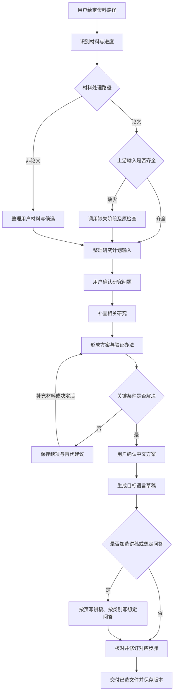

# 研究计划草稿技能执行计划

整理日期：2026 年 11 月 2 日；接口约定补充：2026 年 11 月 3 日；Markdown 交付调整：2026 年 11 月 4 日；撞车判断补充：2026 年 11 月 26 日；教授方向对齐补充：2026 年 11 月 27 日；方向判决口径补充：2026 年 11 月 27 日。

本文保留已确认的业务要求，并落实第二阶段的真实前置条件、固定版本的 Nix 依赖组合、材料读写及稿件提交与恢复。用户现明确要求撤掉 LibreOffice 测试，Word 以后处理，先把 Markdown 做对。本次将当前交付改为 Markdown，撤回 Word 导出、模板填写及页面核对的当前完成要求，并解除它们对 Markdown 提交的阻塞；研究问题、中文方案确认、正文与引用、修改和版本恢复要求保留。首版由一个主技能承担研究计划自己的工作，上游要求的代理照常调用。

- `Requirement revision`：`rp-requirements-r7-verdict-2026-11-27`。沿用 `rp-requirements-r6-direction-alignment-2026-11-27` 的全部已确认要求；以下四项是用户在 2026 年 11 月 27 日就“一个方向还能不能继续做”追加的要求。四项都落在判决与记录上，不改研究计划本身的完成要求，不改组件接口、状态字段、依赖与交付：
  - 判决与停因闭集（要求一）：用户的实际使用出现了两种相反的错。误杀一侧：第十轮把 24 个方向判成 3 活 21 死，第十一轮把 12 个判成 4 活 1 悬 7 死，而判活判死合规复核按现行规则重读 38 个判定对象，只有 5 个干净命中两条硬门槛，18 个不该记死，独立复核另翻案 9 条。报告里用来判停的 0.05、0.02、2 个百分点、0.93、“判断三项 ≥ 30 且总分 ≥ 60”，`candidate-scoring.md` 一条都没有；B 的报告先写“30/60 这条线 skill 没有、已删”，第 201 行又拿它判死。误活一侧：A 自己写“答案不改变谁的做法”仍以 77.5 判存活，U 的先行核对只有 1 分（三篇只读到摘要）仍进入存活名单。要求补一节把“停”写成闭集：只有「新意落点 = 0」「空白成因 = 0 且已判伪空白」「问题不成立」三类可以判停；「问题不成立」只写 `stop_reason`，分数按既有 0/1/2 判据照实记，不为了配合停因而改写（用户在 2026 年 11 月 27 日审核问答中选择此口径）；五种判决词与各自的分数处理写死；禁止用总分、判断三项合计、任一项 1 分、预注册判据线与效果量线、作者自述的后续工作、单次实现的结果、方法置换或对象置换本身判停；并补一句对称规则——权重不能把 0 分买成通过，分数也不能把 1 分判成停（现行文件只有前一句，唯一接近后一句的“不要因为这一项是 1 就把候选判死”只针对准备档位）。
  - 待补与负结果的记录位置（要求二）：现行 `gate` 只有 `pass`、`hard_stop`、`soft_stop` 三态，而「空白成因 = 0」包含“还没查够三篇”并要求标待补；待补落不进三态，就落进 `hard_stop`，汇总时被读成 dead。N3 子报告 `needs_check` 82.5 被写成 dead、d9 与 d7、d8 同类断链共四处。负结果同样没有位置：W 的 6.4 个百分点里 4.5 到 5.1 来自加权方式、d4 的 λ 那一半是 −0.2、J 在 n_t = 80 时 −59.9%、G 在真实数据上更坏，都被判死，而「新颖性写在哪里」的「解释」位置本来就收“原读法在什么情况下会出错”。要求把 `pending` 与负结果写成可落盘的状态：`pending` 有两个触发条件，一是还没查够三篇，二是推荐所依赖的关键项只有摘要级证据（用户在 2026 年 11 月 27 日审核问答中确认后者）；规定 `pending` 不得改写为 `hard_stop`，并给出负结果与边界题的判定句模板。
  - 证据进来之后怎么改判（要求三）：九项是动手之前的判断，实验跑完后现行文件只有“若证据推翻当前问题或方法，就只返回受影响步骤调整和确认”，没说该记成什么。模型要做二值判决，只能自写判死线，d4 的原文是“判据不是总分，是跑数之前写定的门槛：增益小于 2 个百分点即判死”。要求在 `research-design.md` 补一节五类分流：前提被证伪、效应量小、测量不可靠、效应来自混杂、不可识别，并写清预注册判据是实验纪律、不是选题门槛。
  - 判决前的证据门槛（要求四）：三处已确认的测量失效。d3 的强弱两组份额覆盖都是 0.92，但区间中位宽 0.025 对份额 0.003，相对宽度 8.9 到 13.9 倍，覆盖率是“无信息宽度”买来的；W 的 6.4 个百分点里 4.5 到 5.1 来自“每对等权”改成“每查询等权”；C2 换编码器后偏相关从 Contriever 的 −0.4606 变成 MiniLM 的 +0.0218、BGE-small 的 +0.0910，方向都反了。要求在判决前先过三条：效应量报相对基线的差、噪声尺度与混杂拆分；报覆盖率同时报相对宽度；单一实现的结论换实现、编码器或数据再测一次。
  - 本次只增补判决与记录文档，不改组件接口、状态字段、依赖、安装、交付格式和提交行为；九项权重、两项硬门槛、评分公式、九项 0/1/2 判据、四类撞车、三种结论状态、四种切口、多课题点合并、研究室轴判断与学术脉络定位都不变。批准人：用户；日期：2026 年 11 月 27 日。
- 以下为沿用 `rp-requirements-r6-direction-alignment-2026-11-27` 的已确认要求：沿用 `rp-requirements-r5-collision-scoring-2026-11-26` 的全部已确认要求，并采用用户在 2026 年 11 月 27 日追加的三项要求。三项都落在“研究方向怎么和教授对齐”这一段，不改研究计划本身的完成要求：
  - 判断研究室“轴”的方法（缺口 A）：现有的「范围连接」只分研究室主线 2 分、邻近 1 分、无关 0 分三档，回答的是“这个题目是不是他们做的”，不回答“按哪一组数字写”。用户要求按目标教授最近三年论文稳定报告的那组数字判断研究室在追哪一组指标：只报精度的是算法组，报延迟和功耗的是系统组，报吞吐和硬件利用率的是协同设计组；同一句“让模型更省资源”，这三类研究室都会说有关，但面试追问不同。计划要按对方报的那组数字写。该节是对齐策略，不是第十个评分项，不改变九项权重、两项硬门槛、评分公式和「范围连接」的 2/1/0 判据。
  - 学术脉络定位（缺口 B）：「空白成因」要求最接近的三篇在问题上就不同，查的是同一层级的相近工作，防的是伪空白；它查不出“本稿的问题属于哪个更大的脉络、那个脉络里已经有多少人做”。用户以“研究对象没人研究过，换成上位说法后先行研究多得读不完”为例，说明这是定位错误而不是空白。要求补一节：换上位说法重新定位，数该脉络里已有多少工作，并写明本稿接在哪个脉络的哪一支。该节与「空白成因」并列，不替代它。
  - 多课题点同时解决（缺口 C）：撞车一节已接了“即便存在相近论文也仍然重要的课题”与换切口四种；没有接“指出多个课题点，做成同时解决它们的形式”。用户要求补这一半：合并多个已承认的缺口一次解决，适合撞车严重的题，因为它不靠“没人做过”。合并要有条件，不能用缺口数量代替可说明的变化。
  - 本次只增补写作与面试判断文档，不改组件接口、状态字段、依赖、安装、交付格式、交付状态和提交行为。批准人：用户；日期：2026 年 11 月 27 日。
- 以下为沿用 `rp-requirements-r4-collision-2026-11-26` 与 `rp-requirements-r5-collision-scoring-2026-11-26` 的已确认要求：
  - 撞车诊断不设篇数上限：去掉「五篇左右」，改为「篇数不设上限，不按固定篇数停手」。用户实际一次拉了七篇相关文献，固定篇数会让模型提前停手。
  - 评分细则不新增维度：在 `references/candidate-scoring.md` 增加「撞车类型怎么落到评分」映射，明确撞车判断是诊断，不是第十个评分项；九项权重、两项硬门槛和评分公式不变。
  - 沿用 r4 的撞车判断范围：四类撞车（完全重复、方法置换、对象置换、同结论不同路径）；三种结论状态（一致、矛盾、评价空白）；三步诊断（读「研究局限」与「未来工作」、四列表、三问）；四种切口（收窄条件、换评价轴、换假设、仲裁矛盾）；两个以上信号；面试三句应答及措辞边界。内容落在 `references/research-design.md`，在 `SKILL.md` 的相关研究步骤接入，并在 `references/interview.md` 的三类追问末尾加一行指针。需求 r6（`rp-requirements-r6-direction-alignment-2026-11-27`）在「四种切口」之外另补安全做法「多课题点合并」（独立成段，不计入四种切口的计数），四种切口本身不变。
  - 本次只增补写作、面试判断与评分映射文档，不改组件接口、状态字段、依赖、安装、交付格式、交付状态和提交行为。批准人：用户；日期：2026 年 11 月 26 日。
- 以下为沿用 `rp-requirements-r3-interview-2026-11-25` 的已确认要求：`rp-requirements-r2-markdown-2026-11-04` 的 Q6–Q16 决定与“给我删掉用这玩意测试。word的可以以后慢慢调，把markdown弄对就好了”，并采用用户在 2026 年 11 月 24—25 日会话中的两项要求：
  - 研究计划的完成度：“研究计划要写到什么程度为止，是「我作为一个学生我对xxx感兴趣，所以我要学习xxx然后进行xxx研究」，还是说要专注于研究课题，然后真的说清楚怎么做。”
  - 面试发表：“需要用一个ppt来说明你入学后的研究计划和到现在为止的研究/工作经历的面试或者提交的说明书文本……写这些文本和准备面试稿有什么经验。”
  - 范围决定：用户在确认“本次实际包含两块内容（研究计划完成度 / 讲稿与想定问答）”后选择“两项都算本次范围”。批准人：用户；日期：2026 年 11 月 25 日。
  - 新颖性、先行研究关系与准备程度（2026 年 11 月 25 日追加）：用户提供的两批调查材料要求补充四件事：新颖性到什么程度算够、与教授已有论文是什么关系、改先行研究某一步之前要分清什么、方法的准备要到什么程度。第二批材料同时指出“方法必须自己动手做过”过严，并给出学校募集要项与竞争性经费申请说明的原文，要求改为按执行细节判断。据此在 `references/research-design.md` 增加「新颖性写在哪里」「与教授已有研究的关系」「改动先行研究的某一步之前」「准备到哪一步算够」四节，在 `references/interview.md` 增加「必须能当场回答的三类追问」，并在 `SKILL.md` 的相关研究与中文方案两步接入上述判据。
- `Plan revision`：`rp-plan-r11-verdict-2026-11-27`，取代 `rp-plan-r10-direction-alignment-2026-11-27`；r10 的修订内容并入本版，r9、r6 及更早计划中未被本次增补触及的条款继续有效。
- `Target repository revision`：`research-proposal` 仓库分支 `feat/verdict-gate`，基线 `56369ad`（PR #7 合并后的 `main`）；源码采用 `skills/research-proposal/`。已安装产品基线仍指 `b983497308157dedec6b4d97f16c95dc0b0f60f9` 用于历史对照，本次交付以前者为准。
- `Proposed review status`：`pending`，正式结论由独立计划审核记录给出。
- 唯一完整计划是本文件，即 `plan/implementation-plan.md`。此前开发工作树中的同名副本不再作为依据；审核记录位于 `plan/implementation-plan-review.md`。

目标为工作区下的独立技能仓库 `research-proposal`，本地仓库与开发工作树已建立。首版面向日本高校修士申请，学科不限，具体用于联系教授、正式申请或面试准备。它接收用户给定的资料路径，整理已有研究材料；论文路线按需调用现有工作流补齐输入，非论文路线首先处理用户提供的材料，最终生成可继续修改的研究计划草稿。

**已确认的方向**如下：

- 论文路线支持直接使用 professor-contact 已有产物，用户无需逐个提供文件；尚未运行时，新技能负责调用所需前置流程。
- 专著、史料、作品等可以作为主要研究材料，按类型处理并保留出处和定位信息。首版支持用户提供的材料，暂不承诺自动采集各种档案库和作品平台。
- 通过依赖复用原仓库的入口、脚本、代理和检查规则，相关产物仍由原仓库负责生成。
- 每个选题都补查教授之外的相关研究；影响研究能否开展的关键条件须先解决，再生成完整正文。
- 研究计划在选定研究问题和确认中文研究方案两处取得用户决定；已有确认和明确授权继续有效。
- 每份草稿绑定一个申请项目、一种用途和一个核心研究问题，可包含必要的子问题；同题申请其他学校时另存稿件。
- 当前先交付与正式正文一致的 Markdown，并按用途加选发表讲稿与想定问答；支持读取用户修改稿继续修订，并保存稿件版本和中断进度。Word 导出、学校表格填入及排版调试延后，不作为本轮完成条件。
- Nix 是主要安装入口，同时支持通过 npx skills 安装技能及随附资源。
- 新仓库不以 `.apm` 作为目录或安装前提，两种安装方式共用一份技能源码。
- 首版由一个主技能组织材料整理、研究设计、写作和核对，暂不新增研究计划专用代理；上游要求的代理照常安装和调用。
- 首版完整流程以“苹果芯片 Mac、Codex、Nix”为支持目标，通过实际验证后再声明可用；其他组合分别验证后增加。
- 研究计划与套磁邮件各自保存选择和后续状态，共用前面的论文证据与候选想法。

**写作依据**来自用户提供的本地参考文件 `RP.docx`；原件及其私人路径不纳入产品仓库。保留其中的写作顺序：为什么研究、想解决什么问题、准备怎么做、预期得到什么。文档中的题目、个人经历、研究方法和引用只作示范，不自动成为申请者事实或默认选题。

实际章节、语言、栏目和篇幅以目标学校的正式要求为准。研究计划需要额外说明相关研究、验证办法、可行性和进度时，由新流程补齐；这些内容是本次工作流建议，并非参考文档强制规定的栏目。

**用户提供路径后，技能自动发现材料**。输入可以是专攻目录、`教授研究` 目录、单个教授目录、某份具体产物，或用户提供的专著、史料、作品等材料的路径。技能在给定资料范围内识别材料类型、已有产物、所属申请项目或教授、研究方向和当前进度，并展示可用材料、可继续的选题和缺项。

已有明确的教授、方向或选题决定时直接使用；存在多个可选对象而用户尚未指定时，展示选项后取得决定。不能按目录顺序、展示名称或模型偏好替用户选题，也不能仅凭文件存在就认定阶段已经完成。

现有材料的用途如下：

| 现有材料 | 研究计划中的用途 | 使用限制 |
|---|---|---|
| `info.json`、`boshu_analysis.json`、招生说明和正式申请表 | 确定学校、专攻、年度、用途、语言、篇幅和提交要求 | 核对适用年度与专攻；往年材料只能作为暂定参考 |
| `papers.json` | 找到论文条目、题名、年份、作者及全文可用情况 | 论文存在或下载完成，不代表已经分析全文 |
| `方向预筛.json` | 展示摘要支持的初步方向，帮助选择范围 | 初步分类不能直接作为全文结论或研究空白的证明 |
| `套磁候选输入.json` | 复用论文事实、方向、作者后续工作及已有核对结果 | 保留来源、证据范围和不确定性 |
| `套磁候选状态.json` | 复用候选想法、研究问题、支撑论文和风险提示 | 每份研究计划围绕一个核心问题及必要子问题展开，不能简单拼接多个候选 |
| 已有套磁选择 | 作为研究计划选题的预选信息 | 研究计划单独保存自己的选择，不自动把所有邮件选题写成研究计划 |
| 个人资料、`方向素材.json`、用户补充 | 写真实动机、已有准备、兴趣和条件 | 只采用用户实际提供的经历；不把兴趣改写成已经掌握的能力 |
| 论文全文分析及其事实文件、作者后续工作证据文件 | 支撑相关研究、方法比较和选题依据 | 区分论文结果、作者建议和申请者设想；必要时补读关键段落 |
| 教授导读、问答和知识库报告 | 帮助理解术语、研究方向和个人兴趣 | 作为辅助阅读材料，不替代论文证据或用户选择 |
| 用户提供的专著、史料、作品及其他非论文材料 | 支撑研究对象、问题、相关研究和方法选择 | 按类型保留出处、页码、章节、档案编号或其他定位信息，不套用论文的“作者后续工作” |

读取上游产物时，主要采用结构化文件，Markdown 用于展示和辅助理解，不从上游受管 Markdown 反向拼出缺失的正式状态。这与 [professor-contact 的现有产物分工](https://github.com/ScholarWorkflow/professor-contact/blob/ad096fe31a4b5694cbe47a40f37b621435e1eeec/.apm/skills/professor-contact/docs/workflow-reference.md#L80)保持一致。研究计划自己的 Word 或 Markdown 修改稿可以在用户指定后读入，更新本稿内容及状态；这不改变上游正式状态的生成方式。

非论文材料由新技能按类型整理和引用。尚无明确研究问题时，提出少量相互有区别的候选，每个说明材料依据、研究价值、可采用的方法和主要缺项，再由用户选择或修改。这部分的输入、候选和选择保存在研究计划自己的状态中，不要求生成套磁候选文件；论文路线继续复用上游流程。

招生材料还需要单独检查正式研究计划表格。现有招生分析会跳过空白表格，而栏目、页数和填写提示可能就在表上，不能仅凭已有招生摘要认定要求齐全。相关依据见工作区的[招生材料处理规则](../../../StudyCoachWorkflow/admissions-data/.apm/skills/boshu-analyzer/SKILL.md:114)。

**论文路线的前置流程按已有进度继续**。“此前没有跑过 professor-contact”只影响从哪一步开始，不应要求用户先手工运行完整套磁流程。以下条件均以原流程检查认可的有效产物为准。

| 发现的有效材料 | 下一步 |
|---|---|
| 已有有效的 `套磁候选输入.json` 和候选想法 | 直接进入研究计划选题与设计 |
| 已有有效的 `套磁候选输入.json`，缺候选想法 | 调用 professor-contact 第三阶段 |
| 已有论文分析报告或事实文件，但缺少有效的 `套磁候选输入.json` | 先检查该教授的有效 `套磁目标.json` 和第一阶段候选快照；缺失或失效时补齐所需预筛、阶段 0、阶段 1，再由第二阶段按原规则复用分析、生成输入包，最后调用第三阶段 |
| 已完成第一阶段，尚未形成正式输入包 | 调用 professor-contact 第二、第三阶段 |
| 已有方向预筛 | 沿用或取得方向选择，再调用第一至第三阶段 |
| 已有教授论文资料，缺方向预筛 | 调用 professor-research 的方向预筛，再进入后续阶段 |
| 只有合格的招生项目资料，尚未整理教授研究 | 调用 professor-research 的采集、预筛，再进入 professor-contact 前置阶段 |

调用上述上游流程，仍需要足够的招生项目或教授信息。只有一个空目录、学校名称或原始网页时，还需要说明和补齐前置资料；本次讨论尚未把“从任意网页建立完整招生项目目录”纳入新仓库职责。非论文路线可以从用户提供的材料开始整理，同时补齐本稿所属申请项目、用途和要求。

第三阶段不会直接读取论文全文、分析报告、事实文件或 `论文分析/_index.json`，因此不能把这些零散材料视为可直接进入第三阶段的正式输入。相关依据见[第三阶段读取范围](https://github.com/ScholarWorkflow/professor-contact/blob/ad096fe31a4b5694cbe47a40f37b621435e1eeec/.apm/agents/professor-contact-idea-generator.agent.md#L24)。

进入第二阶段前，新技能的路由组件依次落实以下步骤，不能将“发现分析报告”作为跳过条件：

1. 绑定本次申请资料根目录和单个教授目录。原有目标状态由 `contact_targets resolve --target-file` 核对；缺目标、选择已失效或需要新选择时，先补有效预筛，再委派阶段 0 的 `professor-contact` 取得或沿用真实用户决定。
2. 委派 `professor-contact-downloader` 完成该教授第一阶段。它使用同一目标文件检查或建立候选快照，仅补齐缺少的候选全文，并在补齐后重建快照。
3. 将同一目标文件交给 `professor-contact-analyzer`。该代理按原约定先验证第一阶段快照，再运行第二阶段预检；既有分析能否复用由原来的论文身份、来源和缓存检查决定，不能按标题相似或文件名直接挂接。
4. 第二阶段生成有效输入包后才进入第三阶段。已有有效输入包可按上表直接交第三阶段，不为执行这份前置清单而重跑第二阶段。

这一顺序依据 contact 基线 `ad096fe31a4b5694cbe47a40f37b621435e1eeec` 的[第二阶段预检](https://github.com/ScholarWorkflow/professor-contact/blob/ad096fe31a4b5694cbe47a40f37b621435e1eeec/.apm/skills/professor-contact/scripts/_stage2_preflight.py#L877)：代码先读目标，再读教授本地第一阶段快照；缺少快照时返回 `missing_stage1_snapshot`，不会进入分析复用路径。修订只改变新技能的调用顺序，不改变上游前置检查。

补齐时复用原流程的检查、缓存和恢复行为。已有有效产物直接复用；缺失或经原流程判定失效的部分交给对应阶段处理。教授和方向选择、需要下载全文时的访问方式、原流程要求的执行通道和处理范围选择、全文分析后的方向变更，以及追加校验轮次等用户决定仍然有效，不能由新技能绕过。

前置调用运行到 professor-contact 第三阶段完成后，转入研究计划自己的选题流程。第四阶段会编译邮件输入，第五阶段会生成邮件，因此不作为研究计划的必经步骤。第一至第三阶段仍须调用各阶段负责的代理，并按其[正式入口及收尾要求](https://github.com/ScholarWorkflow/professor-contact/blob/ad096fe31a4b5694cbe47a40f37b621435e1eeec/.apm/skills/professor-contact/SKILL.md#L20)完成检查、保存和记录；候选文件生成不等于第三阶段已经完成。

第三阶段需要处理指定方向时，使用 `direction_id` 明确方向。`refresh_scope=selected` 读取的是套磁流程的 `套磁选择.json`，不能将研究计划自己的选择直接作为该参数的依据，也不应为此先运行套磁第四阶段。相关依据见[第三阶段参数约定](https://github.com/ScholarWorkflow/professor-contact/blob/ad096fe31a4b5694cbe47a40f37b621435e1eeec/.apm/skills/professor-contact/SKILL.md#L663)。

整体流程如下：

**研究计划部分分为七步**。

1. **整理用途、要求和材料**。确定本稿所属的日本修士申请项目，以及联系教授、正式申请或面试准备中的一种用途，记录语言、篇幅、栏目、研究期限及适用来源。区分论文和非论文材料的处理路径，整理真实的个人准备和资源条件。缺少格式要求时，可以先按明确标注的暂定格式起草；缺少的事实不能由格式假设替代。

2. **收敛研究问题**。从上游候选、非论文材料形成的候选或用户自己的想法出发，说清研究对象、条件、想弄清的问题和本次范围。每份研究计划围绕一个核心问题展开，可以包含必要的子问题。技能先提出解释与收窄建议，再由用户选择或修改；这是研究计划自己的第一处确认。已有明确选择时直接继续。单纯“开发一个工具”还需要说明准备用它检验什么判断或发现什么规律。

3. **补齐选题证据**。先复用已有分析，每个选题都补查教授之外的相关研究，并围绕选定问题补读关键材料。资料足以支持“已有研究、具体区别、方法依据”后即可停止，不按固定篇数凑数，也不要求查遍整个领域。若仍有可能推翻选题的矛盾证据，就针对该问题继续补查。整理“已有研究做了什么、还缺什么、本计划尝试什么”的对应关系，保留来源、定位信息和结论适用范围；无法取得的关键证据保留为缺项，不写成已经核实。

4. **形成具体研究方案**。为各研究目标提出方法、步骤、数据或研究对象、验证办法、进度和备用方案，并核对关键条件是否成立。先形成中文方案与大纲，便于用户理解和修正；关键条件解决后，由用户确认中文研究方案，这是第二处确认。技能先给出具体建议，只询问确实影响方案的缺失信息，不要求用户先提出完整研究设计。

5. **生成目标语言草稿**。在关键条件已解决、中文方案已确认后，按学校要求组织章节，生成日文、英文或中文正文。需要图示才能解释清楚时，增加简洁流程图。写预期成果时保持计划性表述，不将设想写成已取得的结果。Markdown 从已采用的结构化正文生成，核对实际栏目、篇幅与引用，不能直接改导出文件后宣称正式正文已同步。

6. **按需准备讲稿与想定问答**。本稿 `inputs.deliverables` 含 `script` 或 `qa` 时，先从学校要项确认这场面试的形式（发表几分、是否发表、口述配点），再按页保存讲稿、按类别保存想定问答，最后由同一稿件生成对应 Markdown。要项没有规定发表时不自行假设需要讲稿。讲稿里的方法、期限和数字必须与正文一致；正文或方案变了，这两份交付文件一起重做。

7. **核对并修订**。检查问题、方法和验证办法是否相互对应，引用及定位信息是否支持论断，个人经历和资源取得状态是否如实表述，栏目和篇幅是否符合要求，以及 Markdown 与正式正文是否一致；加选讲稿与想定问答时，另核对它们与正文一致、时长与字数相称。发现问题后返回对应步骤修订；不影响方案成立的未定细节集中保留在待确认清单，关键条件仍未解决时不能标为完整草稿。语言润色放在内容确定之后，保留术语、引用和原有确定程度。

除上游已有的必要选择外，研究计划保留“选定研究问题”和“确认中文研究方案”两处用户决定。后续只有研究问题、核心方法或关键数据条件发生实质变化时，才说明变化及影响，重新确认受影响部分。用户已经明确要求的修改直接执行，无需再次确认；措辞、排版和不改变结论的引用修正也直接处理，未受影响的确认和成果继续复用。

研究设计至少需要回答以下问题；具体办法随学科和课题选择：

| 问题 | 方案内容 |
|---|---|
| 准备怎样开展研究 | 方法、实施步骤、采用理由，以及与研究问题的对应关系 |
| 需要什么材料或条件 | 数据、研究对象、设备、软件和取得条件 |
| 怎样判断结果 | 对照方法、评价指标、理论证明、材料比较、解释依据或其他适合课题的验证办法 |
| 能否按期完成 | 与实际研究期限对应的进度安排 |
| 条件不成立时怎么办 | 可缩小的范围、替代数据或备用方法 |

现有论文事实文件能够提供研究问题、对象、方法、发现、贡献和局限，但不保证数据、实验设置、对照方法和评价指标已经齐全。因此应在选题后补读需要的段落，不默认再次批量分析全部论文。相关依据见[全文事实字段约定](https://github.com/ScholarWorkflow/paper-analysis/blob/c140658cc60f9d9c3d17008cbab0b599f40c8e46/.apm/skills/paper-analysis/SKILL.md#L65)。

写作时始终区分论文已经报告的结果、作者明确提出的后续工作，以及申请者计划验证的设想。作者提出过某项后续工作，不代表现在仍未解决；现有核对结果只能说明其覆盖材料中的情况，不能直接推广为整个领域无人研究。相关依据见[现有后续工作核对范围](https://github.com/ScholarWorkflow/professor-contact/blob/ad096fe31a4b5694cbe47a40f37b621435e1eeec/packages/professor-contact-codex/.apm/agents/professor-contact-analyzer.agent.md#L559)。

出现相互矛盾的结论时，先区分尚未解决的学术分歧与研究对象、时期或方法不同造成的表面矛盾。真实分歧可以成为研究动机，方案须说明争议在哪里、各方依据是什么，以及本研究准备澄清哪一部分，不预先承诺解决整个争议。若新证据动摇了选题或方法的关键前提，返回相应步骤调整。

**关键条件解决后再生成完整正文**。数据、设备、材料访问或招募等条件，须有经过核实的取得途径、可满足的申请条件和合理备用办法；不要求申请前已经取得全部资源。正文分别写明“计划申请”“符合申请条件”和“已经获得”，不能把前两项写成第三项。

没有可靠取得途径且缺少备选时，仍列为未解决条件。技能先提出替代材料、方法或缩小范围的建议，由用户选择或补充；此前保存已有证据、方案和缺项，暂不生成完整正文。不影响方案成立的细节可以保留在待确认清单。

个人经历只采用用户实际提供的信息；未获确认的事实保留为缺项，不编造实验结果、提高幅度或成功承诺。不同课题选择适合自己的方法，不统一套用“开发系统加用户实验”。

默认正文结构建议为：

1. 研究题目。
2. 背景、动机与先行研究。
3. 研究问题和目标。
4. 研究方法与验证办法。
5. 研究进度和可行性。
6. 预期成果。
7. 参考文献。

学校有固定表格时，将上述内容映射到对应栏目，按其要求删并或调整顺序。

**依赖复用按原仓库的职责执行**。

| 仓库或能力 | 在新流程中的职责 |
|---|---|
| professor-research | 教授及论文资料采集、方向预筛，以及原流程需要的定向全文补齐 |
| professor-contact | 方向选择、候选论文准备、论文证据整理、候选想法生成及其检查 |
| paper-analysis 及相关工具 | 通过上游正式调用关系提供论文分析、提取和证据文件 |
| 新建的研究计划仓库 | 发现输入、安排缺失步骤、处理用户提供的非论文材料及其选题、整理申请要求、研究设计、写作、核对和稿件版本管理 |

新仓库通过 Nix 引用并锁定上游包，调用实际安装后的正式入口。上游脚本、代理、检查规则和产物格式继续由原仓库维护。已核对的固定提交提供采集、方向预筛、套磁阶段和搜索所需包导出，本次不修改上游仓库。材料定位、修改稿导入、Markdown 导出和稿件保存由新仓库负责；Word 模板填入属于延期部分。

前置产物由原入口写入，研究计划保存自己的输入、选择和修改状态。新技能不能手写原阶段状态来替代正常执行，也不能把某阶段失败或缺输入记成已完成。外部服务、资料或用户决定不足时，说明受影响步骤，并保留已经完成的有效成果。

**固定依赖基线与调用入口**。新仓库顶层声明三个输入：`nixpkgs@6510408d147d8c5e6d76043e899e9251756f6a75`、`agent-env-nix@c368871942435bdc178a1063ce9c677acaf8cabc`（其 `nixpkgs` follows 本仓库）与 `github:ScholarWorkflow/professor-contact/ad096fe31a4b5694cbe47a40f37b621435e1eeec`（其 `nixpkgs`、`agent-env-nix` follows 本仓库）。递归依赖仍取自 `professor-contact` 的锁定图：`research = professor-contact.inputs.professor-research`，`base = professor-contact.inputs.base-skills`，`source = research.inputs.browser-pdf-tools.inputs.source-access-skills`，系统固定为 `aarch64-darwin`。顶层声明只改变输入接口，四个构建输出与只引用单个输入时逐字节相同。下文表格与说明中的 `contact` 均指 `professor-contact` 这一顶层输入，`contact.inputs.*` 指该输入锁定图内的对应节点。

| 固定来源 | 提交 | 用途 |
|---|---|---|
| professor-contact | `ad096fe31a4b5694cbe47a40f37b621435e1eeec` | 套磁阶段 0—3、原检查和递归依赖图 |
| `contact.inputs.professor-research` | `bb27533540715c44039c108302f11d3e00d6b62e` | 教授采集和方向预筛 |
| `contact.inputs.agent-env-nix` | `c368871942435bdc178a1063ce9c677acaf8cabc` | 共享包构造、一次组合安装和激活 |
| `contact.inputs.nixpkgs` | `6510408d147d8c5e6d76043e899e9251756f6a75` | 新仓库的固定运行程序 |
| `base` | `3ab2ac188e625b8a8ae37b5fa318c579787c3d1e` | 图片阅读及扫描文字识别 |
| `source` | `2fb5c2f1d7a5f5eb53d389bdb1853cdb525700d8` | 通用与日文来源搜索 |

其他递归依赖保留该 contact 提交的完整锁定图，包括 paper-analysis `c140658cc60f9d9c3d17008cbab0b599f40c8e46`、browser-pdf-tools `0a1ad04a3118bc9ac6e8dfe82f9fa53534fe5635`、zotero-tools `24eb6cf596c082ac005ccdd800b962fbb6a8e2c8` 和 contact 直接使用的 pdf-processing-core `2be1bf850f29b7ccf7bd1b066ae7292aac33fc87`。不另行更新到各仓库主分支，也不重写这些依赖自己的锁定项。

| 新技能调用的能力 | 实际包输出 | 运行入口及输入 |
|---|---|---|
| 套磁阶段 0—3 | `contact.packages.aarch64-darwin.professor-contact` | 原生命名代理 `professor-contact`、`professor-contact-downloader`、`professor-contact-analyzer`、`professor-contact-idea-generator`；检查和收尾使用已安装技能内的 `contact_targets`、`contact_stage1`、`contact_state` 等固定入口，校验代理照原约定调用 |
| 初始教授采集 | `research.packages.aarch64-darwin.professor-collector` | `professor-collector`，传资料目录 `folder_path`、已有教授范围和 `skip_pdf:true`；定向补全文仍归第一阶段调用 |
| 摘要方向预筛 | `research.packages.aarch64-darwin.professor-topic-clustering` | `professor-topic-clustering`，传同一资料目录、已有教授范围和 `preview:true` |
| 相关研究搜索 | `source.packages.aarch64-darwin.duckduckgo-search` | 已安装的 `duckduckgo-search` 技能及其 `duckduckgo` 服务的 `search` 工具 |
| 日文来源补查 | `source.packages.aarch64-darwin.yahoo-japan-search` | 已安装的 `yahoo-japan-search` 技能及其同名服务的 `yahoo_web_search` 工具 |
| 扫描页和图片文字识别 | `base.packages.aarch64-darwin.vision-tools` | 固定引用 `base.apps.aarch64-darwin.vision-glance.program`，调用 `<图片路径> --ocr`，需要时附 `--region X1,Y1,X2,Y2` |

新包把以上六项声明为真实直接依赖，即使其中部分已经出现在 contact 的递归依赖中，也取原输入图内的同一包对象。根据[固定版本的 research 导出](https://github.com/ScholarWorkflow/professor-research/blob/bb27533540715c44039c108302f11d3e00d6b62e/flake.nix#L34)，collector 和 topic-clustering 两项已经存在；不能用本地较旧工作树缺少文件来推断需要新增。搜索输出见[固定来源搜索包](https://github.com/StudyCoachWorkflow/source-access-skills/blob/2fb5c2f1d7a5f5eb53d389bdb1853cdb525700d8/flake.nix#L28)，图片入口见[固定 vision-tools 定义](https://github.com/ScholarWorkflow/base-skills/blob/3ab2ac188e625b8a8ae37b5fa318c579787c3d1e/nix/vision-tools.nix)。

联合安装使用 `contact.inputs.agent-env-nix.lib.mkAgentPackage` 构造新包，再用同版 `mkProject` 以 `roots = [ researchProposalPackage ]` 一次组成环境；缓存激活复用同版 `mkCachedActivation`。不分别激活多个环境来累加安装，也不把只含脚本资源的 `professor-contact-runtime` 当完整依赖。

同名包的处理方式已经确定：复用原输入图中的包对象，不重新导入或覆盖 Zotero、浏览器、共享技能的包实例。共享安装器按包身份去重；不同实例或导出名称冲突时保留错误，不靠安装顺序覆盖。依据见[固定安装器的依赖遍历与冲突处理](https://github.com/RekiDunois/agent-env-nix/blob/c368871942435bdc178a1063ce9c677acaf8cabc/lib/project.nix#L9)。

**安装以 Nix 为主要入口**。仓库安排如下：

| 项目 | 约定或建议 |
|---|---|
| 仓库位置 | 当前项目目录下的 `research-proposal` |
| 技能源码 | `skills/research-proposal/`，脚本、参考规则和模板随技能保存 |
| Nix | 主要安装入口；固定依赖版本，安装实际需要的技能、代理、脚本环境和工具配置 |
| npx skills | 安装同一份技能及随附资源；额外运行要求须明确说明 |
| `.apm` | 新仓库不以它作为目录或安装前提；依赖上游包时不要求用户另跑 APM |
| 新仓库的代理 | 首版由一个主技能承担研究计划自己的材料整理、研究设计、写作和核对，暂不新增专用代理 |
| 上游代理 | 从头生成输入时，照常安装并调用上游要求的代理 |
| 首版完整流程 | 以苹果芯片 Mac、Codex、Nix 为支持目标，通过实际验证后再声明可用 |

新仓库导出 `packages.aarch64-darwin.research-proposal-runtime`、`research-proposal`、`research-proposal-environment` 和 `research-proposal-activate`，分别提供固定运行程序、含直接依赖的技能包、组合环境和共享激活入口。脚本通过固定解释器和参数数组调用 Pandoc、图片识别与文档转换程序；不能仅填写 `runtimePackages` 就假定它们已进入 `PATH`。

安装用法一并固定：对上述输出使用 `nix build "<固定产品引用>#<输出名>" --out-link <本轮链接>`；组合环境以 `<环境输出>/bin/agent-env apply --project <使用目录>` 安装。`mkCachedActivation` 显式设置 `name = "research-proposal-activate"`，因此缓存入口为 `<激活输出>/bin/research-proposal-activate --project <使用目录>`。产品引用绑定发布仓库和实际提交，不以本地源码路径作为使用目录安装来源；提交尚未产生属于实施顺序，不影响先编写步骤。npx 安装同一提交中的 `skills/research-proposal`，保留前述安装范围。

一次 Nix 安装负责上述代码、代理、程序和工具服务的启动配置。运行前仍需要用户已有 Codex 及模型访问、Zotero 服务与可用端点、下载时的浏览器条件、图片识别所需模型配置，以及私有依赖的读取权限。这些服务和授权不由安装动作自动取得；按实际使用阶段检查，缺少时保留原错误或缺项，不把采集的部分结果当完整研究证据。

技能正文只维护一份，两种安装方式共用。Nix 复用项目已有共享安装能力，按真实依赖关系组合所需包，不在新仓库另造安装器。安装脚本和运行入口以实际安装位置为准，不依赖开发目录或上游源码中的 `.apm` 路径。相关要求见工作区的 [Nix skill 交付规则](<../../../nix skill rule.md>)。

新仓库不定义专用代理，并不意味着整条流程无需代理。professor-contact 的现有阶段要求使用对应代理，其 npx skills 入口不安装这些代理和工具服务配置。因此，仅通过 npx skills 安装新技能，不能直接宣称从头生成输入所需的环境已经齐全；相关能力需要由 Nix 或已有环境提供。依据见[现有安装边界](https://github.com/ScholarWorkflow/professor-contact/blob/ad096fe31a4b5694cbe47a40f37b621435e1eeec/README.md#L20)。

现有 professor-contact 的 Nix 声明范围是 `aarch64-darwin` 和 Codex，见[上游安装说明](https://github.com/ScholarWorkflow/professor-contact/blob/ad096fe31a4b5694cbe47a40f37b621435e1eeec/README.md#L28)。新技能的首版完整流程以苹果芯片 Mac、Codex、Nix 为支持目标，仍须核对全部依赖并通过实际验证后才声明可用。npx skills 保留技能安装入口，单独安装技能不代表前置代理和运行环境已经齐全。其他平台、运行工具和安装组合后续分别验证、增加，不沿用未经验证的可用声明。

**材料读写采用固定组件**。新仓库的运行包沿用同一 nixpkgs 基线及已安装组件，不为本次交付调整另换依赖。Word 相关实现可以保留，当前 Markdown 流程不调用 Word 生成或预览程序；不以 LibreOffice 就绪、转换或页面检查作为测试及交付条件。

| 组件 | 基线版本 | 本仓库使用范围 |
|---|---|---|
| `python3Packages.pymupdf` | `1.27.2.3` | 输入 PDF 按页提取文字块、页图及位置 |
| `python3Packages.pillow` | `12.3.0` | 图片读取与格式归一 |
| `pandoc` | `3.7.0.2` | 原有载体的结构化读入；由统一正文生成 Markdown，再读回核对 |
| `python3Packages.python-docx` | `1.2.0` | 保留既有 Word 材料读取；模板填写留待后续 |
| `python3Packages.lxml` | `6.1.1` | 读取和处理 Word XML，检查修订及无法直接处理的对象 |
| `libreoffice-bin` | `26.2.4` | 既有 Word 预览实现的依赖；当前不调用、不测试，不阻塞 Markdown |

文字 PDF 使用 PyMuPDF 的 `Page.get_text("dict")` 或 `Page.get_text("blocks")`，保留物理页码和文字块位置；需要看图或文字不足时，用 `Page.get_pixmap()` 生成对应页图。扫描页及图片上的文字交给上表固定的 `vision-glance` 入口识别，不重新实现 OCR，也不触发论文分析。识别的 `[?]`、缺字、无法辨认和服务失败保留为缺项；作品图像的解释与逐字转录分别记录，不把模型解读写成原始题记。资料不足以支持关键论断时，按原有缺项流程处理。

图片识别使用用户显式指定的 `VISION_ENV_FILE`，其中配置 `VISION_API_KEY`、`VISION_BASE_URL`、`VISION_MODEL`，按服务需要设置 `VISION_API_PROTOCOL`；新技能不依赖从任意工作目录自动搜到的 `.env`。Nix 提供客户端，模型服务与额度由用户配置。该固定客户端默认缩小长边超过 1024 像素的图片，因此密集书页、小字或公式按需要裁剪分区识别，记录裁剪在原页中的位置，并核对疑难处。依据见[固定视觉客户端的配置和图像处理](https://github.com/ScholarWorkflow/base-skills/blob/3ab2ac188e625b8a8ae37b5fa318c579787c3d1e/.apm/skills/vision-tools/vision_client.py#L61)。

TXT 和 Markdown 读取原始文本；Markdown、EPUB 和 HTML 经 Pandoc 读取为结构化段落。材料类型与文件载体分别记录，例如“史料”可以存放在 PDF、图片或文本中。首版已列载体之外的文件先报告需要转换的格式，保留原文件，不能把无法读取的内容当成空文档。

材料记录由新仓库的材料组件维护，至少保存材料编号、类型、出处、原文件位置及内容摘要、读取方式和引用定位。PDF 定位到物理页及可用的印刷页标签、文字块或区域；图片定位到原图及像素区域；文本定位到章节、段落或行号；EPUB、HTML 定位到章节或文档片段及段落；Word 定位到段落或表格行列。没有稳定分页的 Word 不编造页码。引用保存材料编号和定位，来源变化时只重查相关摘录与论断，不重新扫描无关材料。接口依据见 [PyMuPDF 页面 API](https://pymupdf.readthedocs.io/en/latest/page.html)和[固定图片识别入口](https://github.com/ScholarWorkflow/base-skills/blob/3ab2ac188e625b8a8ae37b5fa318c579787c3d1e/.apm/skills/vision-tools/bin/glance)。

**修改稿先导入为待处理正文，再决定如何继续**。本轮以 Markdown 修改稿完成验证，保留用户交回原件，由固定 Pandoc 读入结构并与正式正文比较。既有 Word 修订、批注及不支持对象的导入实现保留，当前不追加 Word 验证；后续调试时仍须保留原件和未决修订，不把批注当正文或悄悄丢弃内容。

新仓库保存一份结构化正文 `正文.json`，采用固定 Pandoc JSON 文档结构，并在稿件记录中关联章节、引用和材料定位；Markdown 从这一份正文生成。用户交回 Markdown 时也经 Pandoc 读入同一结构。正文结构保存内容，学校栏目要求决定标题和顺序；Word 表格中的摆放位置暂不处理。不能直接覆盖导出稿而不更新正式正文及状态。

用户指定最新修改稿，只表示本轮使用该稿作为修订来源。导入组件比较该稿与其基准版本，形成内容差异和受影响的研究问题、核心方法、关键数据条件。研究问题和中文方案分别有自己的修订编号及用户决定记录；纯措辞或排版变化沿用原确认，实质变化只使受影响的确认需要处理。用户明确要求的实质修改按原话记录为该部分的决定，不重复询问；文件中未说明意图的实质变化才交用户确认。引用或新事实仍须对应材料，用户编辑本身不替代证据核对。

**Markdown 独立导出和核对**。公开 `export_revision` 省略 `formats` 时生成本稿全部已选交付文件，也可按名只补一份。由正式正文生成 Markdown，再读回比较标题、段落、列表、表格、引用及链接的内容和顺序；加选的讲稿与想定问答由已保存内容重新生成后逐字比较。核对绑定实际正文、引用及各交付文件的内容摘要；发现丢失、手改或不支持的内容时保留工作稿，不能提交不一致的新稿。当前交付不读取或复制 Word 模板，也不调用 Word 生成、PDF 转换和页图程序。

学校提供表格时，仍读取并落实其中的栏目、语言和篇幅要求，将其组织为 Markdown 的标题与正文；不声称已经填写学校原表。Word 模板填入、双格式交付及页面排版调试延后，不保留为本轮验收义务；既有代码和历史失败可以保留，不要求更换审批方式或继续诊断 LibreOffice。

**当前交付 Markdown，并可按需加选讲稿与想定问答，另存待确认事项及输入、状态记录**。以下名称作为当前文件约定，结构中未影响业务的辅助字段由实现者按需要补充。

| 文件 | 用途 |
|---|---|
| `研究计划草稿.md` | 与正式结构化正文一致，可直接阅读、修改和继续讨论的研究计划草稿 |
| `研究计划讲稿.md` | 加选 `script` 时生成，按页给出分配时长与要讲的话 |
| `研究计划想定问答.md` | 加选 `qa` 时生成，按类别给出问与答及时长估算 |
| `研究计划待确认事项.md` | 集中记录缺失条件、待核对论断和需要用户决定的事项 |
| `研究计划输入.json` | 保存本稿申请项目、用途、采用的上游或用户材料、要求、选题及来源 |
| `研究计划状态.json` | 保存研究方案、用户决定、步骤进度、当前采用的正文版本及未完成内容 |

输出仍是研究计划草稿，保留不影响方案成立的待核对或讨论事项。交付路径只包含该版实际通过核对的交付文件（Markdown，以及加选时的讲稿与想定问答）；旧 Word 或预览产物留在其原记录中，不混入新稿交付，也不标记为已经成功或已修复。

**每份稿件独立保存，修订时明确采用哪一版**。实际草稿保存在用户资料目录中，每份绑定一个申请项目、一种用途和一个核心研究问题，允许包含必要的子问题。同题申请其他学校时另存稿件；文献证据和通用研究方案可以复用，学校要求、具体正文及修改进度分别保存。

用户明确指定了最新正文时，以该版本为本轮修订依据，并保留导入原件及其基准版本；没有交回修改稿时，沿用上次提交的正文。出现多个互相冲突的版本时，由用户指定本轮采用哪一版，不按修改时间自动合并。每份稿件有独立编号，申请项目、用途、核心问题与其绑定；跨校另建稿件编号，只显式复用材料和方案。

**版本保存以一份核对完成的交付集为提交单位**（Markdown 正文，加选时含讲稿与想定问答）。在每份稿件目录内，`研究计划状态.json` 是当前版本和进行中修订的唯一入口；它区分已提交版本、工作版本、研究问题及中文方案的确认、已完成步骤和缺项。当前工作版由组件记录 `delivery_formats:["md"]`；Word 不进入当前交付。交付文件由 `inputs.deliverables` 决定：`md` 必有，`script`、`qa` 按用途加选；加选是用户决定，不按用途自动补上。正文、Markdown 和必要的输入记录按修订编号放在独立目录中，旧版本不覆盖，用户导入原件单独保留。程序只为本稿更新状态，不建立跨稿件事务服务。

提交顺序固定如下：

1. 读取当前已提交版本及本轮工作版本，建立本轮独占工作目录。每次完成材料读取、方案确认、正文修订或一个导出步骤后，将结果保存到该工作目录，再更新进行中进度；不提前改当前已提交版本。
2. 在同一工作目录保存结构化正文，再生成 Markdown 和待确认事项。各步骤记录所使用的正文、引用和相关输入内容摘要，便于中断后判断哪些结果仍适用。
3. Markdown 与正式正文一致、关键条件和适用确认均有效后，才具备提交条件。核对记录包含由组件确定的 `checked_formats`（等于本版全部已选交付文件）和 `content_consistent`；提交要求两者与当前交付集一致；不要求或伪造 `pages_ok`。对同一稿件的状态更新使用本地 `fcntl.flock` 文件锁；耗时的模型调用期间不持锁，回写时核对本轮基准仍未改变。冲突时保留各自工作目录，不覆盖另一轮的决定。
4. 进行中状态先记录准备提交的修订编号、工作目录、目标版本目录和已完成核对；在同一文件系统内把完整工作结果目录改名为该修订的版本目录，然后用临时文件写出新状态，最后以 `os.replace` 替换 `研究计划状态.json`。状态中的当前版本指向新目录才表示提交完成。用户收到的交付文件路径来自这一个已提交版本。恢复只定位该记录指明的修订，不扫描后按最大编号或修改时间猜测当前稿。
5. 状态替换之前失败，当前版本保持旧值；目录已改名但状态未切换时，该目录只是待接续结果，不自动成为当前稿。状态替换之后中断，新版已经提交，恢复时重报该版文件即可，不重新生成或退回旧版。

| 结果或中断位置 | 当前有效正文 | 恢复行为 |
|---|---|---|
| 交付文件及正文核对完成，状态已切换 | 新提交版本 | 交付该版全部已选文件，保留旧版 |
| Markdown 导出失败 | 上一提交版本；首次生成时尚无已提交稿 | 保留工作正文和已有有效步骤，输入未变时只补失败步骤，完成核对后再提交 |
| 交付文件与正式正文或保存内容不一致 | 上一提交版本 | 保留实际修改及原正文，按修改稿流程处理后重新核对，不覆盖用户编辑或提交不一致的新版 |
| 材料、研究方案或正文阶段中断 | 上一提交版本 | 从已保存的有效步骤继续；未保存的当前步骤重新执行 |
| 版本目录已完成，但尚未切换状态 | 上一提交版本 | 对照进行中修订、输入和确认，符合原提交条件则完成状态切换，否则保留为待处理结果 |
| 正文、已采用材料、学校要求或用户选择在恢复前改变 | 上一提交版本 | 仅使相关工作步骤失效；实质变化按既定规则处理用户确认，再重新导出受影响内容 |

这份安排使用每稿一个状态文件和版本目录，不引入跨文件日志服务。正文或引用变化使 Markdown、讲稿、想定问答及其核对失效；讲稿内容变化使两份讲稿交付与核对失效；只补失败导出的前提是相关输入仍相同。延期的 Word、页面或摆放模板变化不阻塞当前交付；作为研究材料或学校要求已采用的输入仍按原依赖规则处理。遇到用户手改导出稿，先经 `import_revision` 保留原件、读取差异并采用用户决定，再保存正式正文和重新导出，不能直接重导覆盖。

**旧稿按原位置续接**。新建工作版一律采用 `delivery_formats:["md"]`。旧未提交工作版没有该字段时，由公开 `resume_revision` 在文件锁内明确补入并递增状态版本，只使旧交付核对待重做；材料、问题、中文方案、正文及仍有效的用户决定保留，其他真实输入变化仍照原规则处理。旧 Word 失败、未完成页图和旧双格式摘要不作为新 Markdown 提交的缺项，也不改写为成功。已有已提交双格式记录继续按历史要求只读解释，不原地迁移或改动其文件；从旧版建立的新工作版采用 Markdown。新交付及恢复返回只汇总当前要求中的实际文件，不把旧 Word 混入新稿。原路径和版本冲突、待提交目录恢复及最后切换状态的规则不变。

技能仓库保存通用技能、模板和必要脚本，不将用户的实际申请材料放入产品源码。

**主技能与组件之间使用以下公开约定**。这些是本仓库自己的业务调用接口，不改变上游接口，不增加独立服务。实现源码放在 `skills/research-proposal/scripts/research_proposal/`；`api.py` 导出下表同名函数，每个函数接收一个 JSON 对象对应的 Python `dict`，返回一个可序列化的 `dict`。主技能通过同源的 `scripts/proposal-runtime <操作名> --request <JSON文件>` 调用，标准输出为该结果对象，诊断写标准错误。Nix 运行包提供相同的 `bin/proposal-runtime` 和包含该模块及上表依赖的 `bin/python3`；安装后的脚本使用该固定运行包，不能导入开发工作树。此处规定主技能需要的组件边界，内部辅助函数和文件拆分仍由实现者决定。

所有操作结果含 `status` 和 `issues`。`status` 使用 `ready`、`needs_input`、`blocked`、`conflict`、`committed`，分别表示本次操作完成、需要用户材料或决定、无法完成、基准已变化、完成版本提交；`ready` 不代表整份稿件已提交。`issues` 为 `{kind, message, location}` 数组，无问题为空数组。结果中的路径是解析后的绝对路径。命令完成且结果为 `ready` 或 `committed` 时退出 0，其余业务状态退出 2；意外程序错误非零退出，保留原错误，不改成成功。Python 入口与命令行保持相同业务结果。

| 公开操作及函数 | 请求中的业务字段 | 返回内容及责任 |
|---|---|---|
| `discover` | `path`；可选 `selection: {professor_path, direction_id}`，只传用户已有选择 | `objects` 数组，每项有 `application_root`、`professor_path`（非论文可空）、`materials`、`valid_artifacts`、`next_step`；`selected` 为选中项的路径或空。`valid_artifacts` 是有效正式产物的名称到路径映射。有效性沿用上游原检查，不能按文件存在断言有效。`next_step` 使用 `collect`、`preview`、`stage0`、`stage1`、`stage2`、`stage3`、`proposal`、`read_materials` 或 `needs_input`，表示下一项必要业务；有多对象且没有选择时返回 `needs_input`，不执行上游代理 |
| `read_material` | `path`、`material_type`、`source`、`output_dir`；`source` 是用户提供的出处字符串 | `material` 包含 `material_id`、`material_type`、`source`、`original_path`、`digest`、`reader`、`blocks`、`issues`。每块为 `{block_id, text, locator}`；定位包含 `kind` 和该载体实际可得的页、区域、章节、段落或表格位置。另存图像解释时用 `interpretation`，不放入逐字转录 `text`。保存提取结果，保留原文件；无法读取的内容以缺项返回 |
| `import_revision` | `path`、`baseline_body`（基准 `正文.json` 路径）、`output_dir` | `body` 为待处理 Pandoc AST；`original_copy` 指向保留原件；`changes`、`comments`、`unsupported` 分别返回 `{kind, text, location}` 数组，保留未决修订和具体位置；Markdown 的普通内容差异也进入 `changes`。此操作只读入和展示差异，不接受修订、不覆盖正式正文、不擅自更新用户确认 |
| `begin_revision` | `proposal_dir`、`inputs`、`expected_state_version`（首次创建为 `null`，既有稿为读取到的整数版本） | 创建采用 `delivery_formats:["md"]` 的工作版本，返回 `revision_id`、`directory`、`state_version`、`state`。`inputs` 至少含 `application_id`、`purpose`、`question_id`（尚未选择可空）、`material_paths`，以及已有的项目要求、来源和用户选择；既有 `template_path` 可保留为空或历史引用，不作为当前 Word 填写要求。新稿建立自己的输入与状态文件，既有稿以当前提交为基准 |
| `save_revision` | `proposal_dir`、`revision_id`、`expected_state_version`、`stage`、`data` | `stage` 为 `materials`、`question`、`scheme`、`body` 或 `interview`，保存该步骤结果并返回新的 `state_version`、`state`。`interview` 保存 `script`（发表讲稿）与 `qa`（想定问答）两项内容，字段与检查见 `references/interview.md`。材料步骤保存材料记录；问题步骤保存 `question_id`、`text`、`confirmation`；方案步骤保存 `scheme`、`conditions`、`confirmation`；正文步骤保存 `body`（Pandoc AST）和 `references`（材料编号、定位与正文关联）。问题与方案的 `confirmation` 是 `{revision, status, decision}`，状态为 `confirmed` 或 `needs_input`，`decision` 保存用户原意和来源；`conditions` 为 `{resolved, notes}`。主技能负责语义判断并据真实用户决定传入，组件不从文件存在推定授权。正文只在关键条件和相关确认有效时保存；变更只使依赖它的工作和确认失效 |
| `export_revision` | `proposal_dir`、`revision_id`、`expected_state_version`；可选 `formats` | 省略 `formats` 时生成本稿全部已选交付文件，也可按名只补一份（如 `["script"]`）。从正式正文与已保存的讲稿内容生成 Markdown，返回 `state_version`、`state` 和实际生成的 `artifacts`，不切换当前版本。没有在 `deliverables` 里加选的文件不能导出。仅 Markdown 不检查或复制 Word 模板，不生成 Word 或预览；旧 Word 分支及其 `template_path`、`mapping` 参数可保留为延期实现，不作为当前调用或可用性承诺 |
| `review_revision` | `proposal_dir`、`revision_id`、`expected_state_version`；当前不需要 `page_review` | 实际读回全部已选交付文件核对：Markdown 与正式正文比较，讲稿与想定问答与保存内容重新生成的文本逐字比较；保存 `checks.content_consistent`、`checks.checked_formats`（全部已选文件）、`checks.deliverable_digests` 及相关摘要，返回 `state_version`、`state`、`checks`。只补导出一份时也核对全部已选文件。核对与正式正文、引用及 Markdown 实际内容绑定；相关内容改变即失效。缺文件或内容不符不能由调用者给出成功标记补齐；不调用页面程序，不写页面成功 |
| `commit_revision` | `proposal_dir`、`revision_id`、`expected_state_version` | 按既定文件锁、待提交记录、目录改名和最后切换状态的顺序提交。实际核对当前交付要求中的全部交付文件、摘要、确认、条件和对应核对记录，未齐全则保留工作版本；延期 Word 的状态不影响提交。返回 `state_version`、`state`，成功另有已提交目录的实际 `artifacts`，不混入旧 Word |
| `resume_revision` | `proposal_dir`、`expected_state_version`；可选 `revision_id`、当前 `inputs` | 依据唯一状态入口定位工作或已提交版本，核对相关输入及工作文件内容摘要，返回 `state_version`、`state`、`next_steps` 和仍有效的交付文件。旧未提交版本按前述方式明确转为 Markdown，保留有效进度并要求重新核对；已提交记录只读。目录已改名但指针未切换时，仅按明确待提交记录续接；正文、材料或用户选择改变时使相关步骤失效。当前 `next_steps` 不要求 Word 或页面；手改 Markdown 须先保留和导入，不能覆盖后再报告恢复 |

材料定位 `locator.kind` 使用 `pdf`、`image`、`text`、`epub`、`html`、`docx`；物理页使用从 1 开始的 `page`，图像或 PDF 区域用 `bbox`，文本用从 1 开始的 `line`、`paragraph` 及可用的 `section`，电子书和网页用 `fragment`、`paragraph`，Word 用从 0 开始的 `paragraph` 或 `table`、`row`、`column`。缺少的定位字段不编造；引文直接引用记录内的材料编号和定位。模板的 `target` 使用 `{paragraph}` 或 `{table, row, column}`，也均从 0 开始。正文关联和定位均由实际读入生成，不要求用户事先填写。

`研究计划状态.json` 保持 `schema_version: 1`，保留 `proposal_id`、`binding: {application_id, purpose, question_id}`、`state_version`、`current`、`works`。`current` 为空或 `{revision_id, directory}`；`works` 以修订编号为键，每项含 `directory`、`base_revision`、`inputs`、`fingerprints`、`steps`、`confirmations`、`conditions`、`checks`、`pending_commit`，新工作版增加由组件设置的 `delivery_formats:["md"]`。历史已提交记录缺此字段时按原双格式要求只读解释，未提交记录在公开恢复中迁移。`steps` 为 `materials`、`question`、`scheme`、`body`、`interview`、`docx`、`md`、`script`、`qa`、`review` 十项，当前交付不依赖 `docx`；读回旧状态时把缺失的步骤补成未开始，只补键、不改已有步骤与用户决定，新增步骤没有保存件时摘要为 `None`，不判为内容变化；状态仍为 `complete|pending|failed`，不能把延期项改成成功。`checks` 增加实际核对的 `checked_formats`，旧页面字段不参与 Markdown 通过判断。`fingerprints` 由组件计算实际正文、材料、交付格式及采用的输入／决定摘要，不接受调用者伪造；核对摘要只依赖本版交付要求中的实际产物。`pending_commit` 仍为空或 `{revision_id, work_directory, target_directory}`，对应前述提交恢复安排。

提交后在 `works[revision_id]` 保留该版记录，将其 `directory` 更新为版本目录并清空 `pending_commit`；已提交记录供读取，不再原地修订，因此 `works[current.revision_id]` 可取得该版材料、确认、条件及核对结果。`begin_revision` 从当前版本复制仍有效的材料、问题、方案、确认、正文及讲稿内容到新工作目录；按新 `inputs` 只使受影响部分失效，新工作版的各交付文件导出和核对另行完成。新工作版沿用旧讲稿保存件，因此讲稿步骤中的内容会一并带过去。旧版本文件和记录保持不变；对已提交版的手动修改经导入流程进入新工作版本。

每次状态修改递增 `state_version`；包括创建和恢复在内，写入调用均须传入上次读取的 `expected_state_version`，在锁内核对。调用方可直接读取正式状态文件取得版本；首次创建传 `null`，只在锁内确认状态文件仍不存在时允许建立，初始版本为 1，否则返回 `conflict`。恢复时先读取现存状态的版本，不使用中断前缓存的计数；若其后另一轮改变状态，仍返回 `conflict`，不能将旧 `inputs` 写入新决定。保存或提交工作还要核对其 `base_revision` 未被另一轮提交替代；已提交的同一修订只重报结果。若模型返回前另一轮已改变状态，保留本轮工作和新返回内容，不覆盖对方结果。该计数只用于本稿的过期写入检查，不是跨稿件事务设施。`resume_revision` 根据当前状态和原有进行中记录恢复，不能凭过期计数绕过新决定。内存中的状态不算保存成功；文件替换失败保留磁盘上的旧指针。

本次保留九个公开操作，只改变当前交付集、核对与提交前置及旧未提交稿的恢复。论文前置顺序、上游代理、依赖版本、材料读取、用户确认、文件锁和最后替换状态的顺序沿用 r3。调用者仍通过业务函数操作状态，不另提供测试专用命令、故障开关或通用事务接口。

**面试发表讲稿与想定问答按用途加选**。这是本修订新增的交付，服务“用一个 PPT 说明入学后的研究计划和以往研究/工作经历”这类面试与说明材料。它不是新代理，也不是自动产物：只有本稿 `inputs.deliverables` 列出 `script`（逐页讲稿）或 `qa`（想定问答）时才要求。

| 对象 | 保存与检查 |
|---|---|
| 讲稿 `script` | `timing` 给目标时长、页数、每分钟口述字数、允许误差；`sections` 按页给页码、标题、分配时长、实际要讲的话，可选画面要点。检查页数与页码连续、每页有标题与正时长、各页时长合计与目标时长的差、以及按字数折算的时长与目标时长的差都不超过允许误差；`chars_per_minute` 须在 100 至 700。字数按非空白字符统计 |
| 想定问答 `qa` | 按类别给 `question`、`answer`，可选 `source`。检查条目非空、每条答案按每分钟字数折算不超过 `max_answer_minutes`（省略时按 1.5 分钟）、`required_categories` 非空且不重复、每个必备类别至少一条问题、`category` 属于声明的类别 |

- 两项共用 `save_revision(stage="interview")` 一个保存步骤。后一次保存会带上步骤里已有的另一项，本次请求显式给出的那项覆盖旧值，因此补齐缺项不必重写全部内容。
- 该步骤只能覆盖、不能删除单项，也没有删除入口；提交 `null` 或空对象一律报错，已保存内容不会被覆盖或删除。新工作版总是从已提交的当前版本复制，因此已提交稿里的讲稿会带到新工作版；未提交工作版里的讲稿改动不会进入新工作版。确实要丢掉某项时只能另建稿件目录，本稿保留原记录。
- 保存过的内容一律参与检查，即使那一项没有加选；未加选的内容不通过时，该步骤保持未完成并阻塞已加选文件的导出。
- 讲稿与想定问答都从正文派生。正文、研究问题、中文方案或材料变化时，两份交付文件与核对一起重做；只改讲稿内容时，两份讲稿交付与核对一起失效，正文与 Markdown 交付保持完成。
- 加选或取消 `deliverables` 属于本稿输入变化，会连带使正文步骤失效，因此加选后需要重新保存正文再导出。

**交付、核对与提交的条件**。下表是调用方需要知道的完整前置；字段名、默认值与具体报错文本以 `references/interview.md` 为准，本计划冻结的要求、owner、失效规则与提交条件优先。两者不一致时先按本计划执行并修正参考文件；差异若改变正式行为，按计划修订流程处理。

| 环节 | 前置与结果 |
|---|---|
| 加选交付 | `deliverables` 必含 `md`；`script`、`qa` 可加选；`docx` 不能列入。只写 `script` 或 `qa` 时自动包含 `md`。省略该字段只交付 Markdown。 |
| 保存讲稿 | 不要求正文已完成，可以先保存讲稿内容；两项都只能提交非空对象，写成 `null` 或空对象会被拒绝，已保存内容不被覆盖或删除。正文未完成时导出返回 `body_required`。 |
| 导出 | 正文、讲稿步骤均完成；未加选的文件不能导出（`deliverable_not_selected`）。省略 `formats` 生成本稿全部已选文件。 |
| 核对 | 总是核对本稿全部已选交付文件，并把 `checked_formats` 记为这一整组；只补导出一份不改变这一点。 |
| 提交 | 正文、`md`、`review` 及每个已选交付步骤都完成；`checks.content_consistent` 为真且 `checked_formats` 等于当前交付集；各交付文件存在且摘要与记录一致。 |
| 讲稿必填项 | 讲稿需 `timing`（目标时长、页数、每分钟字数、误差）与 `sections`；想定问答需 `chars_per_minute`、`required_categories` 与 `items`，`max_answer_minutes` 可省略，省略时按 1.5 分钟。 |

**研究计划的完成度有明确下限**。`references/research-design.md` 的「写完到什么程度」一节适用于所有稿件，不只是加选讲稿的稿件。它给出六条底线与对应的“不必有”清单，并要求写明方案弱点；这些是写作判断，不是组件可自动检查的字段，由主技能在形成方案与正文时落实。学校栏目、语言和篇幅要求仍然优先。

**新颖性按位置说明**。同一文件的「新颖性写在哪里」一节规定：区别要落在问题、方法、对象或数据、解释之一，并说明依据；四项都没有变化时回到选题。「与教授已有研究的关系」与「改动先行研究的某一步之前」两节规定引用归属、问题归属，以及改动前区分权衡与失误、确认动手条件。讲稿与想定问答的「必须能当场回答的三类追问」把改动落点、评价依据与方法经验写进问答准备。这些同样是写作与面试判断，不是组件检查项。

**撞车判断**。`references/research-design.md` 的「撞车怎么判断」一节规定：搜到大量先行研究时先分清完全重复、方法置换、对象置换、同结论不同路径四类，再按结论一致、结论矛盾、评价空白三种状态决定动作；用读「研究局限」与「未来工作」、四列表、三问完成诊断，篇数不设上限、不按固定篇数停手；发现撞车后优先换切口（收窄条件、换评价轴、换假设、仲裁矛盾），仍须落到「新颖性写在哪里」的四项之一；出现两个以上信号时回选题复查。面试应答三句放在同一节，要求点名先行研究、指出适用边界、说明本稿位置，不把边界说成对方失误。这些是写作与面试判断，不是组件检查项。`SKILL.md` 的相关研究步骤增加指向该节的入口，`references/interview.md` 的「必须能当场回答的三类追问」末尾增加一行指向该节的指针，不改变三类追问的数量和必答要求。

新节只是诊断层，不替代既有规则：四位置判定和 `skills/research-proposal/references/candidate-scoring.md` 的权重、硬门槛仍是正式规则；两个以上信号触发回选题复查，不单独判定候选成立或不成立；仲裁矛盾只承诺澄清可界定的分歧，不承诺解决整个争议；评价空白是文献诊断，只有落到四位置之一并满足「换基底或指标」的更高门槛，才算可写的空白。新节不得写入用户材料中的真实人名、学校、机构、产品名或具体论文示例，只保留通用规则和抽象例子。

**撞车判断与评分**。`references/candidate-scoring.md` 增加「撞车类型怎么落到评分」一节：撞车判断是诊断，不是第十个评分项；新增第十维会重复计分并需要重排权重，故采用映射；九项权重、两项硬门槛和九项 0/1/2 判据不变；映射只说明四类撞车、三种结论状态落到「先行核对」「空白成因」「新意落点」「价值」的哪一项，不重述、不收紧判据；「先行核对」仍要求三篇最接近的工作，撞车诊断阶段读多少篇不设上限。

**准备到什么程度算够**。`references/research-design.md` 的「准备到哪一步算够」一节规定：不要求申请前已经做过，判断依据是能否把执行细节说到位；给出五档可信度、D 档的硬要求、条件不足时的替代动作与正文的三段写法，并列出一年制项目与教授要求现成数据这两种例外。它同时修正本分支上一版草稿（`da1ea06`）中“方法必须自己动手做过”的绝对说法；该句不在 r5 已批准的计划内。

**研究室的轴怎么判断**。`references/research-design.md` 新增「研究室的轴怎么判断」一节，位置在「与教授已有研究的关系」之后、「改动先行研究的某一步之前」之前；「与教授已有研究的关系」末尾加一行指针。该节规定：读目标教授的近年论文，看它们稳定报告哪一组数字——只报精度的是算法组，报延迟和功耗的是系统组，报吞吐和硬件利用率的是协同设计组；按对方报的那组数字写计划，同一句“让模型更省资源”在三类研究室里写出的方法、评价与追问都不同。“稳定报告”的口径写死为：读到的近年论文里，主结果表以那一组指标为主的占多数；只出现在对比表里的一侧指标不算。判断要附论文篇名、年份和发表处，不看标题和摘要里的名词。这些篇名属于对用户分析输出的要求，不写进技能文档正文；技能文档只保留判断方法和抽象例子。三年只是观察窗口；教授换轴或跨轴时按最近两三篇的实际主指标记录，不硬套三分类；非计算类学科沿用同一原则，看对方论文稳定报告的评价方式与取证方式，不把三分类当成适用条件。适用范围写清为“阅读与说明”：可用于理解教授在做什么、作为判断「范围连接」2/1/0 的输入、以及准备面试；「范围连接」的权重仍按原规则默认 0，只在用户明确要求把“导师能不能带”纳入比较时调整，该节不自行启用或提高权重。不用于筛选教授、不替代 `discover` 的教授方向决定（该决定归上游阶段 0 的原代理与用户），也不替代本稿的问题确认。该节是对齐策略，不是第十个评分项：九项权重、两项硬门槛、评分公式和「范围连接」的 2/1/0 判据都不变，`candidate-scoring.md` 只在「可加的一项：范围连接」末尾加一行指针，不新增评分项、不改判据、不加分数要求。入口归属逐项写明：`SKILL.md` 的中文方案步骤加指针（判断研究室在追什么时读），相关研究步骤加「学术脉络怎么定位」的指针（见下条），`references/interview.md` 的三类追问末尾加一行指针。

**学术脉络怎么定位**。同一文件的「新颖性写在哪里」与「撞车怎么判断」之间新增「学术脉络怎么定位」一节。**插入位置会改变既有交叉引用，必须同时修正**：`research-design.md` 现第 136–137 行的“完全没有相近先行研究是危险信号，理由见上一节”中，“上一节”目前指「新颖性写在哪里」；新节插入后该指代会落到新节上，因此把这句话改为具名指向「新颖性写在哪里」，否则既有推理链会被打断。该节规定：先说清本稿接在哪个大脉络的哪一支，再谈空白；「空白成因」查的是同一层级的相近工作，查不出“这个说法在上一级有多大一片”。上位说法用“对象＋做法”替换自造词，例如把“没人研究过某类经营者”换成“经营者继承”；换上位说法后先行研究多得读不完，说明是定位错了而不是空白大。产出要求：写上上位说法、该脉络里最接近的三篇及各自位置、本稿落在哪一支、哪一步和它们不同，并写明该脉络里已有多少工作（给出篇数或量级），再附一句该脉络是否已经明显拥挤的判断。这里的“多少”是要求说明规模，不是新的停止条件：阅读篇数不设上限、不按固定篇数停手，r5 的篇数口径不变。与「空白成因」的分工固定：脉络定位先做，避免把定位错误当成空白；做完脉络定位仍可能判伪空白，两节都要过，任何一节不过都不进入方案，新节不替代「空白成因」的三篇证据。入口归属：`SKILL.md` 的相关研究步骤加指针，`references/interview.md` 的三类追问末尾加一行指针。

**多课题点合并**。同一文件的「撞车怎么判断」补「四种切口之外的安全做法」：指出两到三个作者已承认的缺口，做成一次解决它们的形式。**它不是第五种切口**：写成独立一段，放在该节“本节只是诊断层”一段之后，不计入四种切口，现有“四种切口仍要落到[新颖性写在哪里]的四项之一”一句及其计数都不动。该做法不靠“没人做过”，靠“一次补多个洞”，适用撞车严重的题。合并要有条件：每个缺口是该脉络承认的、能指出处与位置；合并后有单一研究问题，不是几件事并列；合并后的判断办法能同时回答这几个缺口，且比分别补更有依据；仍要落到「新颖性写在哪里」的四项之一并写出判定句。合并只改变论证结构，不改变证据要求：每个缺口仍要独立证据，「空白成因」的判据与三篇最低证据不变，「先行核对」仍要求三篇最接近的工作，不能拿三个都只被承认一半的缺口凑成一条新意。

本项另在 `references/candidate-scoring.md` 的「三种常见打错」增加第 4 条“把缺口数量当成新意”，**小节标题同步改为「四种常见打错」并统一计数**，避免标题与条目数自相矛盾。该文件在 r6 轮共两处改动：本条与「范围连接」末尾的指针；r7 轮为四处（新节、报告第 2 条、推荐段、`items` 与 `gate` 说明），另加对称规则与软门槛补法措辞；两处都只作警示与指针，不新增评分项、不固定分数、不加新条件，九项权重、两项硬门槛、评分公式、九项 0/1/2 判据和「范围连接」2/1/0 判据均不变。

**判决与停因**。`references/candidate-scoring.md` 在「先过门槛，再算总分」之后、「打分前先定证据」之前新增「判决与停因」一节，并在「怎么报给用户」第 2 条、「推荐怎么写」第 180 行段末与「保存」的 `items` 说明各改一处。新增节写死以下内容：

- **判决词五种，与 `gate` 一一对应**：`可推进`（`pass`，进入排序）、`待补`（`pending`，缺指定证据，不给总分，补齐后重打）、`备选`（`soft_stop`，总分照算并写补法）、`并入`（`merge`，指向被并入的候选，不给独立总分）、`停`（`hard_stop`，不给总分，另写 `stop_reason`）。
- **停因闭集三种**：`novelty_zero`（新意落点 = 0）、`gap_zero`（空白成因 = 0 且已判伪空白）、`problem_invalid`（问题不成立）。`pending` 有两个触发条件：还没查够三篇；推荐所依赖的关键项只有摘要级证据。两种情况都不得记 `hard_stop`，`pending` 在汇总、比较和转述时不得改写为 `hard_stop`。
- **“推荐所依赖的关键项”写死为推荐语第 2 句点名的领先项**（「推荐怎么写」要求写明在哪几项领先、领先多少），推荐语没点名的项不算；第 2 句点名多项时，任一项只有摘要级证据即记待补。同一情形在「推荐怎么写」第 180 行的现行处理是“补不了就把领先项从推荐理由里去掉”，仍保留总分与排序；新触发条件取代这条路径：领先项只有摘要级证据时整条候选记 `pending`，不给总分、不排序，补完全文或换一个有全文依据的领先项后重打。“先补成 2 分依据再推荐”的方向保留，第 180 行末尾改为指向本节。
- **`problem_invalid` 用五个问句诊断**：两边是否恒等；同一份观测资料是否对应两个相反结论；参数是否依赖不可观测的分布；检验在真零假设下是否必然拒绝或必然不拒绝；定义域是否为空。这一类只写 `stop_reason`，评分表按既有 0/1/2 判据照实记，不为了配合停因改写分数：按判据确实是 0 的（例如恒等式对「四项都没有变化」）就记 0，是 1 就记 1；报告里单列停因，不并入前两种。
- **禁止清单**：总分、判断三项合计、任一项 1 分、预注册判据线与效果量线、作者自述的后续工作、单次实现的结果、方法置换或对象置换本身，都不能单独判停。判据线命中而两条硬门槛都过时，只能记负结果、边界题或备选。
- **对称规则**：在「先过门槛，再算总分」末尾、原文“权重不能把硬门槛买过去”之后追加“分数也不能把 1 分判成停”。
- **价值项自检**：把报告里写价值的原句套回 0 分定义；与“答案是常识，或没人会因此改变判断或做法”同义时记 0，不能记 1。
- **负结果与边界题**：零结果与反向结果写成“先行研究认为 A 在 B 下成立，本稿实测在 B′ 下不成立或更差，因此适用范围是……”，落在「新颖性写在哪里」的「解释」位置，1 分成立；写法细则与五类分流见 `research-design.md` 新节。

`gate` 说明改为“写 `pass`、`pending`、`soft_stop`、`hard_stop` 或 `merge`；`hard_stop` 另写 `stop_reason`；`merge` 另写 `merged_into`（被并入的候选 id）；`hard_stop`、`pending` 与 `merge` 不给独立总分”，并在 `items` 字段清单句写明按 `gate` 另含 `stop_reason` / `merged_into`。这是加值不改名：既有记录里的 `pass`、`hard_stop`、`soft_stop` 保持有效，新值只增不改，已存的 `candidate_scores` 不需要迁移。报告口径第 2 条按五态逐条写清总分处理，并把原文对软门槛用的“待补”改称“备选”；「先过门槛，再算总分」软门槛补法里的“降为备选”同步改为“按备选处理”，避免与新 `备选` 判决词重复。

**证据推翻方案之后**。`references/research-design.md` 在「有限补查」之后、「新颖性写在哪里」之前新增同名一节，内容三块：

- **五类分流**：前提被证伪 → 改写成边界题或负结果，不判死整个方向；效应量小 → 记负结果、边界题或备选，判停须另有停因；测量不可靠 → 先修测量，不产出判决；效应来自混杂 → 拆开混杂后重判；不可识别 → 单列问题不成立（`problem_invalid`）。
- **判据身份**：预注册判据是实验纪律，不是选题门槛；判据前提被推翻时可以改判，但要写清触发事实并重打受影响项，旧分留档并标“旧口径”。
- **判决前的三条证据要求**：效应量同时报相对基线的差、噪声尺度（种子、自助法或重复）与混杂拆分；报覆盖率同时报相对宽度，不只报覆盖；单次实现得出的结论，写进判决前换一次实现、编码器或数据复测，复测反向时先怀疑实现。

`SKILL.md` 在「形成可执行的研究方案」第 2 步（相关研究）末尾加两行指针：判决记录按[判决与停因]写清判决词与停因；证据推翻前提时按[证据推翻方案之后]处置。不新增评分项、不改权重、两项硬门槛、评分公式与 0/1/2 判据。

**插入位置不影响既有交叉引用**。`research-design.md` 需要检查的三处相对指代是：第 71 行“上一节查的是同一层级的相近工作”在「学术脉络怎么定位」内，指其前一节「新颖性写在哪里」，本次插入在其上方，指代对象不变；第 97 行“本节”指「学术脉络怎么定位」自身；第 263 行“见下面的「准备到哪一步算够」”的两节都在插入点下方，顺序不变。`candidate-scoring.md` 第 41 行的“逐项判据见下”指紧随其后的「空白成因 1 分」小节，新节在更下方，不受影响。因此本轮不需要像 r10 那样修正既有指代句。

**本轮决定及事实依据（r7）**：误杀与误活的规模、判死线的种类、`gate` 三态导致的断链、三处测量失效，来自用户 2026 年 11 月 27 日提供的讨论记录（仓库外，用户工作区）：`2026-11-27_判活判死合规复核.md` 的结论摘要与第 3、4 节，`2026-11-27_第十轮_大规模排查与终选.md` 第 41–70、124–135 行，`2026-11-27_第十一轮_存活方向逐一终判.md` 第 15–32 行，`2026-11-27_研究方向独立复核.md` 第 1–20 行，以及 `子报告/B_曲面联合检验_终判.md` 第 201 行、`子报告/d4_复活终判.md` 判决段、`子报告/d3_复活终判.md` 第 11–20 行。这些材料的实际路径与内容不进仓库，只在此记录文件名与行号。现行规则的位置：`candidate-scoring.md` 第 66 行（唯一一条“不要因为 1 分判死”，只针对准备档位）、第 89–110 行（两条硬门槛与“权重不能把硬门槛买过去”）、第 234 行（`gate` 三态）；`research-design.md` 第 30 行（“若证据推翻当前问题或方法，就只返回受影响步骤调整和确认”）、第 46–60 行（新颖性四位置，含「解释」）。这些是文档事实，不是运行行为，已逐处核对当前提交。

**本轮方案选择**：所选方案是在既有两个参考文件内新增加值，不改结构。现实替代方案有四条，均不采用：新建 `references/verdict.md` 单独放判决规则——判决词必须与评分表、`gate` 存档同处，另开会形成两份口径，且 `SKILL.md` 现有入口都指向 `candidate-scoring.md`；只加一句“禁止用判据线判死”——不提供替代表达，实测模型仍会自造，B 的子报告先写“30/60 这条线 skill 没有、已删”，第 201 行又用它判死；改 runtime 组件增加 `gate` 校验——本次是文档口径，组件不校验 `candidate_scores`，改代码会把文档问题变成兼容问题；把 `hard_stop` 改名为 `stop`——既有存档含 `hard_stop`，改名需要迁移且无收益。

**影响与反例**：`intended_change` 是新增两节与五态说明；`preserved_behavior` 是九项权重、评分公式、0/1/2 判据、两条硬门槛的含义、四类撞车、三种结论状态、四种切口、多课题点合并、研究室轴判断、学术脉络定位、`interview.md` 三类追问、组件接口与交付路径；`approved_behavior_change` 是允许把“问题不成立”作为第三个停因、允许负结果与边界题作为可推进形态、允许 `pending` 与 `merge` 两个新 `gate` 值；`prohibited_side_effect` 是用总分、判据线、单项 1 分、作者自述后续工作或单次实现判停，把 `pending` 改写为 `hard_stop`，把方法置换或对象置换本身当停因，以及借新节改动九项权重、公式或硬门槛含义。没有未解决的关键影响。代表性反例逐条由规则处理：五项 2 分、四项 1 分（2 分项权重合计 50，总分 75）的候选不能因“不够高”判停；恒等式可以判停，评分表按判据照实记，是 1 就写 1，由 `stop_reason` 单列说明；`pending` 在汇总表里保持 `pending`，即使另一方向分数更高；判据线命中而硬门槛都过，记负结果或备选；单实现结论换编码器反向，先怀疑实现；新节不能替代「空白成因」的三篇证据，也不能把“还没查够三篇”当伪空白。

**本轮新增与延期**。新增：`script`、`qa` 两项按需交付、`interview` 保存步骤、上述完成度、新颖性、撞车判断与评分映射要求，需求 r6 的研究室轴判断、学术脉络定位和多课题点合并三项写作与面试判断，以及需求 r7 的判决与停因、待补与负结果记录、证据改判与判决前证据要求。延期不变：Word 导出、学校模板填入、页面排版与页图核对。正文变化时 `docx` 步骤会被标为待重做，但它不参与当前交付、核对与提交。

**实现顺序与责任已经确定**。

| 顺序 | 负责仓库与组件 | 实施内容及交接 |
|---|---|---|
| 1 | 新仓库的技能、Nix 定义和运行包 | 在已建立的 `research-proposal` 开发工作树内实现技能；固定上述依赖图、六项直接依赖及材料程序；导出技能包、组合环境和共享激活入口。上游包按现有导出使用，本次不新增上游接口 |
| 2 | 新仓库的输入发现与上游调用组件 | 识别材料和有效阶段；落实阶段 0、1、2 的前置顺序，按原入口委派、等待和消费结果；完成原检查后交接正式输入，不写上游状态替代执行 |
| 3 | 新仓库的材料组件 | 实现各载体的读取、定位、扫描文字识别调用和缺项记录；将非论文候选及选择保存在本稿状态中 |
| 4 | 新仓库的正文及稿件状态组件 | 在已有实现中补入当前交付要求和旧未提交稿恢复，调整核对、提交、下一步及返回产物；保留确认、修改稿导入、文件锁、版本目录和最后切换当前版本的顺序 |
| 5 | 新仓库的导出组件及主技能 | Markdown 路径取消 Word 模板和页面依赖，实际读回交付文件核对正文；主技能、运行说明、交付规则及 README 统一改为当前只交 Markdown 并按需加选讲稿与想定问答，保留 Word 延期说明及旧记录，不调用 LibreOffice。本次另在 `references/research-design.md` 的「新颖性写在哪里」之后、「与教授已有研究的关系」之前新增「撞车怎么判断」，在 `SKILL.md` 相关研究步骤与 `references/interview.md` 三类追问末尾加入口，并在 `references/candidate-scoring.md` 增加「撞车类型怎么落到评分」映射。需求 r6 再在「与教授已有研究的关系」之后新增「研究室的轴怎么判断」、在「新颖性写在哪里」与「撞车怎么判断」之间新增「学术脉络怎么定位」（并修正原“理由见上一节”的指代）、在「撞车怎么判断」的四种切口之外补「多课题点合并」（独立成段、不计入切口计数），并在 `SKILL.md` 的中文方案步骤（轴）、相关研究步骤（脉络、撞车）、`references/interview.md` 三类追问末尾、`references/candidate-scoring.md` 的「范围连接」末尾与「三种常见打错」（改为「四种常见打错」）加入口与警示。需求 r7 再在 `references/candidate-scoring.md` 的「先过门槛，再算总分」之后新增「判决与停因」，把 `gate` 与报告口径改为五态，在 `references/research-design.md` 的「有限补查」之后新增「证据推翻方案之后」，并在 `SKILL.md` 的相关研究步骤末尾加入口 |
| 6 | 新仓库的测试计划与执行负责人 | 按已确认业务目标和项目测试规则准备、审核并执行适用测试；本文件不新增用例编号、专用测试设施或全仓回归要求 |

本次第 1–3 项及其有效结果继续采用，主要实施第 4–5 项，再交第 6 项按受影响范围验证。状态和导出负责人先约定交付要求、核对字段及产物返回；两模块完成后，主技能使用同一公开入口，按新远端提交正式安装，原样恢复现有材料和原路径工作目录，再通过生产接口续接。不能手改消费者代码、旧状态的确认或摘要来补偿实现。

**本次决定及事实依据**：b983 的 [导出组件](https://github.com/ScholarWorkflow/research-proposal/blob/b983497308157dedec6b4d97f16c95dc0b0f60f9/skills/research-proposal/scripts/research_proposal/_documents.py#L387)已接受仅 `md` 的导出子集，但仍处理模板；其核对路径要求双格式及页图。[状态组件](https://github.com/ScholarWorkflow/research-proposal/blob/b983497308157dedec6b4d97f16c95dc0b0f60f9/skills/research-proposal/scripts/research_proposal/_state.py#L652)的核对、提交、下一步和摘要同样要求 Word。由这两个原负责组件调整当前交付要求，才能使用户要求的 Markdown 独立完成；不应在测试侧假填 Word 成功或绕过提交。已有未提交稿已保存有效问题、方案和正文，公开恢复及修改稿导入可以在原路径保留这些成果，具体旧失败与本轮状态见 `test-results.md`。

所选方案复用现有九个操作和状态文件，只明确当前交付集（Markdown 正文，以及按需加选的讲稿与想定问答）与对应保存步骤。现实替代方案是新增另一套“仅 Markdown”状态及命令；它会重复确认和恢复逻辑，故本次不采用。也不将手写 Markdown 当成已提交版本，不用外层诊断生成物替代生产交付。

本轮获用户批准的行为变化是：当前交付 Markdown 正文，并可按用途加选发表讲稿与想定问答；在研究设计中增加撞车判断，并在相关研究与面试追问入口接入；在 `candidate-scoring.md` 增加撞车类型到评分的映射，不改九项权重、两项硬门槛、评分公式和九项 0/1/2 判据；映射只说明落点，不重述、不收紧，不固定 1 分、不新增条件；需求 r6 再增加研究室轴判断、学术脉络定位与多课题点合并三项写作与面试判断，并在相关入口接入；需求 r7 把方向判决写成闭集：五个判决词与 `gate` 一一对应，停只允许 `novelty_zero`、`gap_zero`、`problem_invalid` 三种理由，`pending` 不得改写为 `hard_stop`，负结果与边界题成为可推进形态，并加判决前的三条证据要求（基线差与噪声尺度、覆盖率的相对宽度、单实现的复测）。Word、学校表格填入和页面调试延期，LibreOffice 不参与测试及完成判断。保留上游调用、材料读取、研究设计、两处用户决定、引用依据、栏目篇幅、旧稿保护、过期写入冲突和原路径恢复；保留 `candidate-scoring.md` 的权重、硬门槛和九项判据、「范围连接」的 2/1/0 判据、`interview.md` 的三类追问及既有新颖性四位置。禁止把旧 Word 失败改写为成功、把修改后的 Markdown 与旧正式正文混合提交、覆盖用户修改或改动其他稿件；禁止把用户材料中的真实人名、学校、机构、产品名或具体论文示例写入技能文档。代表性反例已由上述规则处理：旧 Word 失败不阻塞有效 Markdown；Markdown 被手改不能凭旧核对提交；另一轮先更新基准时不能覆盖；旧双格式已提交稿不会被原地迁移；撞车判断不能绕过四位置或评分硬门槛；研究室轴判断不能替代 `discover` 的教授方向决定或本稿的问题确认；脉络定位不能替代「空白成因」的三篇证据；多课题点合并不能把三个各被承认一半的缺口算成一条新意，也不能拿缺口数量顶替「空白成因」的判据；r7 的判决闭集不改变两条硬门槛的含义和九项判据，也不把“问题不成立”算成第十个评分项；r7 的反例由同组规则处理：五项 2 分、四项 1 分（2 分项权重合计 50，总分 75）不得因分数不够判停，恒等式判停时评分表按既有判据照实记（是 1 就写 1）、停因由 `stop_reason` 单列，推荐语点名的领先项只有摘要级证据时记 `pending`、不给总分、不排序，补全文或换有全文依据的领先项后重打，判据线命中而硬门槛通过只能记负结果或备选，单实现结论换编码器反向时先怀疑实现。没有未解决的关键影响。

未受影响的 r3 方案及有效检查继续采用，本次不增加学科、平台、上游、模型或审批方式。正式测试范围与步骤由测试计划独立记录，只撤回延期部分并核对本轮受影响行为。固定依赖及既有安装结果不表示新 Markdown 提交已通过，实际结果仍由执行及第三关给出。
